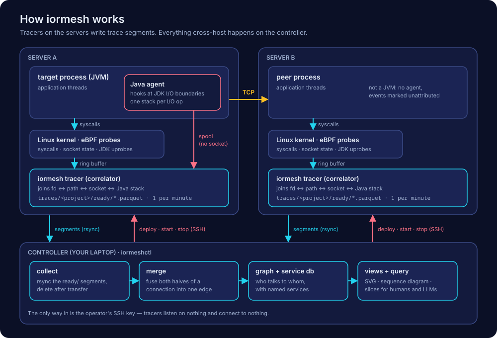
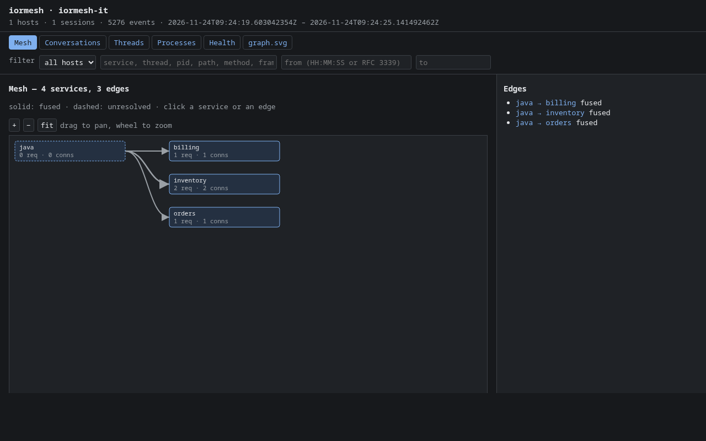

# iormesh

BPF-based process observability mesh: iormesh maps what a PID
touches (files, sockets), follows each connection across the wire
to the process on its other side, and traces the Java code flow
that drove it — across hosts, into one queryable graph. Companion
project to [ior](https://github.com/snonux/ior): where `ior` asks
*"what is this process doing to its I/O right now?"*, iormesh asks
*"what does this process touch — and what touches it back?"*

## How it works

Each server runs one tracer, `iormesh`: eBPF probes plus a
correlator that joins I/O syscalls to the Java stack (via a small
Java agent) and writes trace segments. A controller, `iormeshctl`,
runs on a laptop with no eBPF: it pushes and starts tracers over
SSH, collects the segments over rsync, fuses both ends of each
connection into one cross-host edge, and renders the mesh as a
local site, a terminal UI, SVG and sequence diagrams. Tracers
listen on nothing and hold no credentials; the mesh grows only
from the controller, under an allowlist. Details:
[docs/architecture.md](docs/architecture.md).

**Status: proof of concept.** M0–M7 are accepted; M5's LLM eval
passed with real models on 2026-11-26. Rocky Linux 9.9 is the main
target; flags, paths and schema may still change. See
[docs/milestones.md](docs/milestones.md).

## Documentation

The larger docs are indexes: each lists its parts with a one-line
summary, so read the index and open only the part you need.

### Get started

- [guide](docs/guide/README.md) — the iormesh guide, step by
  step: from zero to a rendered mesh on two Rocky 9.9 hosts, then
  Java code flow, query, tracing for days, expansion and
  Kubernetes; for a human, or an agent working with one.
- [quickstart](docs/quickstart.md) — now a pointer into the
  guide, kept for old links.

### Use

- [visualization](docs/visualization.md) — explore a mesh: local
  site, terminal UI, plain text.
   
- [kubernetes](docs/kubernetes.md) — runbook for tracing pods.
- [troubleshooting](docs/troubleshooting.md) — failures by message.
- [java-attach](docs/java-attach.md) — getting the agent into a JVM.

### Understand

- [architecture](docs/architecture.md) — goals, deployment modes,
  components and how they fit.
- [trace-scope](docs/trace-scope.md) — what is traced, and why.
- [output-contract](docs/output-contract.md) — the trace format,
  built for LLM introspection.
- [schema](docs/schema.md) — the field-level trace schema.
- [decisions](docs/decisions.md) — every numbered decision; the
  source of truth.
- [milestones](docs/milestones.md) — spikes and M0–M7, with
  acceptance.

### Build & test

- [build](docs/build.md) — build, code generation, tech choices.
- [testing](docs/testing.md) — workload-first and integration
  testing.
- [security](docs/security.md) — security and scope.
- [implementation](docs/implementation.md) — work packages with
  code sketches.
- spikes: [S1 Java join](docs/spikes/s1-java-join.md),
  [S2 cross-host](docs/spikes/s2-cross-host.md),
  [S3 overhead](docs/spikes/s3-overhead.md).

[CHANGELOG.md](CHANGELOG.md) — release notes. MIT licensed, see
[LICENSE](LICENSE).
