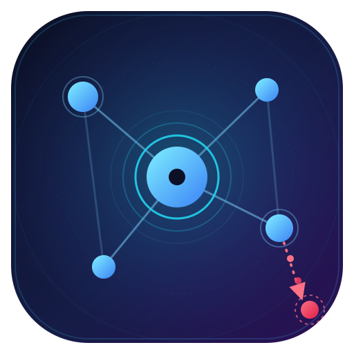

# iormesh

BPF-based process observability mesh: map what a PID touches (files,
sockets), follow each connection across the wire to its other side,
and trace Java-level code flow inside the process.

Companion project to [ior](https://github.com/snonux/ior). Where `ior`
answers *"what is this process doing to its I/O right now?"*, iormesh
answers *"what does this process touch — and what touches it back?"* —
across hosts, not just one.

**Status: early phase — PoC.** This project is a proof of
concept in the making: the repo holds the project plan
([PLAN.md](./PLAN.md)), the design docs ([docs/](./docs/)) and
the first code — M0's Java test workload (`workload/`, built
with `mage workloadBuild`) and M1's BPF build and generator
lifted from ior (`mage generate`, `mage build`; see
[docs/build.md](docs/build.md)). Everything described — flags,
paths, schema, milestones — is subject to change as the PoC
evolves.

## Goals

1. **Full I/O map per PID** — every file op and every network
   socket with resolved IPs and ports, plus the HTTP requests
   riding them (method, URI, headers, status).
2. **A mesh that grows along its edges** — when a connection to
   an untraced host is observed, `iormeshctl` can deploy a
   tracer there, attached to the process accepting that
   connection — from the controller, under an allowlist, signed
   binaries and hop limits. Tracers never deploy themselves.
3. **Java code-flow instrumentation** (JDK 21) — attribute I/O
   events to the method stack that caused them, and to the
   OpenTelemetry span when the app is instrumented.
4. **Correlated, queryable map** — hosts, PIDs, sockets, files
   and Java call stacks in one dataset over time. The end-goal:
   the full picture of how every service talks to every other
   service — in sequence, down to the driving Java threads.
5. **LLM-introspectable trace outputs** — a stable,
   self-describing contract an LLM (or human) can reconstruct
   behavior from and verify against source code.
6. **Rendered mesh** — deterministic SVG and sequence diagrams
   of the mesh, plus an interactive explorer to walk it.
7. **Controller-driven operation** — `iormeshctl` runs on any
   laptop (Linux or macOS, no eBPF), manages the server list,
   pushes tracers over SSH, collects traces over rsync, and
   builds the complete mesh locally.

Nothing gets instrumented "in production" before it has been
proven against iormesh's own traceable test workload — no live
app is ever the first test subject.

## Deployment modes

- **Standalone** — `sudo iormesh` on a host; traces that host.
- **Controller-managed (primary)** — `iormeshctl` on any laptop
  (Linux or macOS) manages the server list, pushes and starts
  tracers over SSH (`add` enrolls, `rm` tears down and removes
  `/opt/iormesh` on the host), collects the traces and renders
  the mesh locally. Plain Linux servers first; Kubernetes is a
  later phase.
- **Kubernetes (later phase)** — sidecar or `iormeshctl`-driven
  `kubectl debug` container (context and image configurable)
  next to the app; pod-aware identity.
- **Mesh expansion** — `iormeshctl expand` follows observed
  connections to untraced peers and deploys tracers there, under
  the allowlist and hop limits (M6). Driven by the controller;
  servers hold no credentials.

## Security in brief

- Read-only tracing, metadata only — no file or socket payload
  is ever recorded. One deliberate exception: HTTP(S) request
  metadata captured at the Java API boundary. One redaction
  policy covers headers, query params, URI paths and argv.
- Mesh expansion only from the controller, against an explicit
  allowlist, with a signed tracer binary, a hop limit and a
  node cap. Tracers never deploy and never connect anywhere.
- No management sockets — the tracer listens on nothing; control
  flows only through SSH (or `kubectl exec`), i.e. the
  operator's key.

Details: [docs/security.md](./docs/security.md).

## Documentation

- [PLAN.md](./PLAN.md) — the working plan: scope, spikes,
  milestones M0–M7, decisions. The source of truth.
- [docs/architecture.md](./docs/architecture.md) — components
  and how they fit together, with diagrams.
- [docs/implementation.md](./docs/implementation.md) — the
  implementation guide: work packages in execution order, with
  code sketches.
- [docs/visualization.md](./docs/visualization.md) — exploring
  a consolidated mesh: local site, terminal UI, plain text.
- [docs/trace-scope.md](./docs/trace-scope.md) — what iormesh
  traces, and why each family is in the model.
- [docs/output-contract.md](./docs/output-contract.md) — the
  trace output format, built for LLM introspection.
- [docs/schema.md](./docs/schema.md) — the field-level trace
  schema: envelope, args, event kinds, graph, files.
- [docs/testing.md](./docs/testing.md) — workload-first testing
  and the ior-style integration suite.
- [docs/security.md](./docs/security.md) — security & scope.
- [docs/build.md](./docs/build.md) — build, code generation and
  tech choices.
- [docs/spikes/s1-java-join.md](./docs/spikes/s1-java-join.md)
  — spike S1's result: the Java↔syscall join, clocks, the agent
  spool, attach mode and cost.
- [docs/spikes/s2-cross-host.md](./docs/spikes/s2-cross-host.md)
  — spike S2's result: the NAT-proof cross-host join key and
  clock bounds from the traffic.
