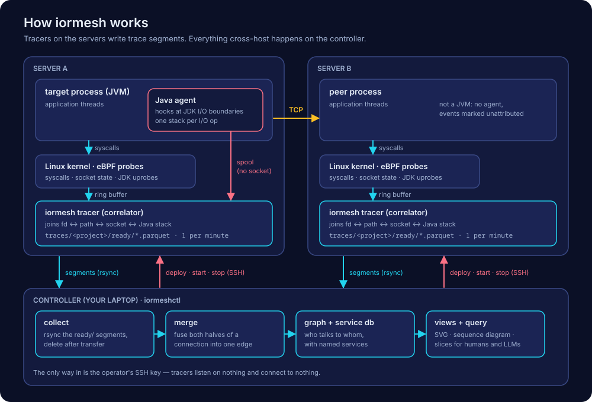
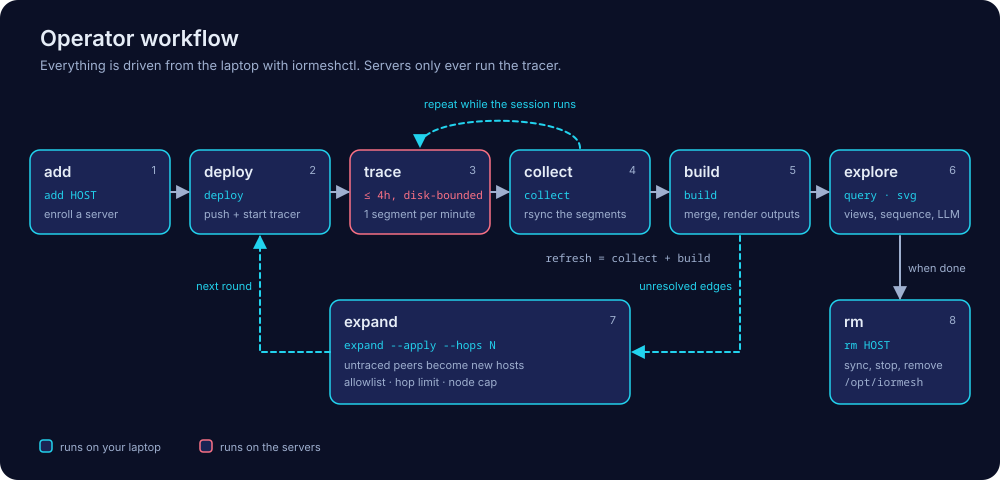
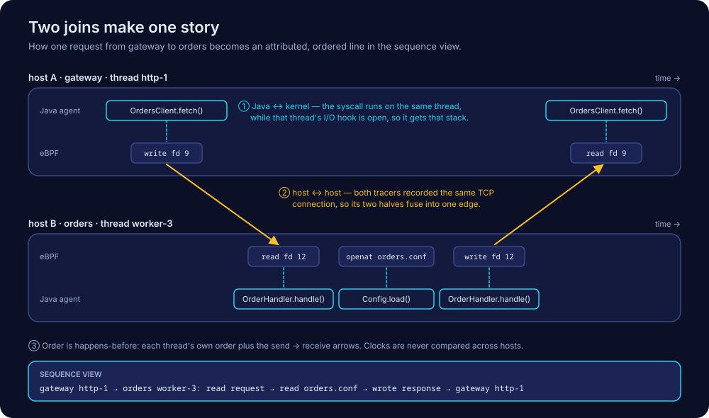
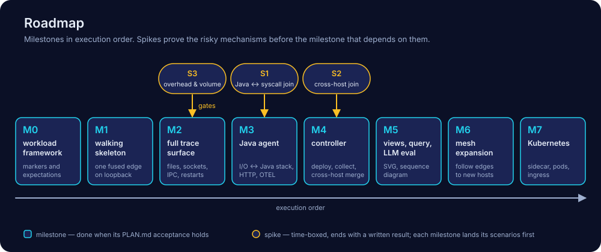

# Architecture

How iormesh is put together: what it is for, the principles it is
built on, its goals and deployment modes, its components and the
repository that holds them. The
decisions behind it are in [decisions.md](decisions.md), the order
it was built in is in [milestones.md](milestones.md); this doc
gives the narrative.



There is no long-lived collector and no mesh agent. Each server
runs one tracer (probes + correlator) that writes trace segments;
everything cross-host — merging, the graph, mesh expansion, the
views — happens on the controller.

## Purpose

What iormesh is meant to show, from one process up to the whole
service mesh.

Map what a PID touches (files, sockets), follow each connection
across the wire to its other side, and trace Java-level code flow
inside the process — correlated into one queryable graph:

hosts ↔ PIDs ↔ sockets ↔ remote PIDs ↔ files ↔ Java method stacks.

The end-goal reads one level up: a complete picture of how
every service talks to every other service — every edge,
in the order it happened, attributed to the Java threads
that drove it — and interleaved with the local file I/O
those same threads performed: which files they opened, what
was read from or written to them. The graph is the source;
the service-level sequence view (M5) and the interaction
database (M4) are the renderings of it.

## Guiding principles

The rules every milestone was held to; [decisions.md](decisions.md)
applies them case by case.

1. **The test workload comes first — per milestone.** We build a
   purpose-built Java test app to be traced, and every tracer
   feature is validated against it *before* iormesh ever attaches
   to a live application. No live app is the first test subject —
   not in spirit, not ever. M0 is the framework, not the whole
   catalogue: each milestone lands its own scenarios before its
   tracer code.
2. **Read-only tracing.** eBPF and the Java agent observe; they
   never change what the target does or the data it handles.
   Observation is not free, though: probes cost time and the agent
   rewrites bytecode at I/O boundaries, so the overhead the target
   pays is budgeted and measured (decision #25). "Read-only" is
   about function — never an excuse to ignore cost.
3. **Expansion is opt-in, bounded and controller-driven.** The
   mesh grows along observed connections only from the controller,
   with the operator's SSH key, against an explicit allowlist,
   with a hop limit and a node cap checked before anything is
   deployed. Tracers hold no credentials and open no connections.
4. **One graph, many vantage points.** Every milestone must end with
   events landing in the same correlated dataset — never a
   per-component output format that needs re-joining later.
5. **Reuse ior's machinery — BPF/C and tests.** The
   code-generation pattern — generated tracepoint handlers,
   generated Go tables, diff-gated results, CO-RE embed, Mage +
   Docker generation host — and the integration-test suite are
   ior's, proven and pinned by its tests. iormesh copies/adapts
   them instead of inventing its own (whoever implements this
   should look at `../ior` for inspiration first — see
   [build.md](build.md), "Code generation — follow ior", and
   [testing.md](testing.md), "Integration tests follow ior").
   Reuse has an edge, though: what ior does *not* provide is
   listed there too, and is planned as new work.
6. **The trace is a document, not a dump.** Outputs follow a
   versioned, self-describing schema with stable ids and explicit
   loss accounting — precise enough for an LLM to reconstruct
   behavior and check it against source code, and, once
   normalized, deterministic enough to diff two runs. A trace is
   too big to read whole, so it is sliceable by query; and the
   LLM claim is tested by an eval (M5), not asserted.
7. **Risk first.** The mechanisms the whole project stands on —
   the Java↔syscall join, the cross-host join, the overhead
   budget — are proven by spikes before milestones depend on
   them, and a walking skeleton (M1) fuses one edge end to end
   before the traced surface widens.

## Goals

What the proof of concept sets out to deliver; each goal maps to
milestones in [milestones.md](milestones.md).

1. **Full I/O map per PID** — every file op and every network
   socket with resolved IPs and ports, plus the HTTP requests
   riding them (method, URI, headers, status).
2. **A mesh that grows along its edges** — when a connection to
   an untraced host is observed, `iormeshctl` can deploy a
   tracer there, attached to the process accepting that
   connection — from the controller, under an allowlist, signed
   binaries and hop limits. Tracers never deploy themselves.
3. **Java code-flow instrumentation** (JDK 17+) — attribute I/O
   events to the method stack that caused them, and to the
   OpenTelemetry span when the app is instrumented.
4. **Correlated, queryable map** — hosts, PIDs, sockets, files
   and Java call stacks in one dataset over time. The end-goal:
   the full picture of how every service talks to every other
   service — in sequence, down to the driving Java threads.
5. **LLM-introspectable trace outputs** — a stable,
   self-describing contract an LLM (or human) can reconstruct
   behavior from and verify against source code.
6. **Rendered mesh** — deterministic SVG and sequence diagrams
   of the mesh, plus an interactive explorer to walk it.
7. **Controller-driven operation** — `iormeshctl` runs on any
   laptop (Linux or macOS, no eBPF), manages the server list,
   pushes tracers over SSH, collects traces over rsync, and
   builds the complete mesh locally.

Nothing gets instrumented "in production" before it has been
proven against iormesh's own traceable test workload — no live
app is ever the first test subject (principle 1).

## Deployment modes

- **Standalone** — `sudo iormesh run -project NAME (-pid PID |
  -pattern GLOB | -listen-port N)` on a host; traces the matched
  processes there.
- **Controller-managed (primary)** — `iormeshctl` on any laptop
  (Linux or macOS) manages the server list, pushes and starts
  tracers over SSH (`add` enrolls, `rm` tears down and removes
  `/opt/iormesh` on the host), collects the traces and renders
  the mesh locally. [The guide](guide/README.md) walks it.
- **Kubernetes (M7)** — sidecar or `iormeshctl`-driven
  `kubectl debug` container (context and image configurable)
  next to the app; each pod is traced as its own host
  (`pod-<uid>`), and every event names its namespace, pod and
  container. See [kubernetes.md](kubernetes.md).
- **Mesh expansion** — `iormeshctl expand` follows observed
  connections to untraced peers and deploys tracers there, under
  the allowlist and hop limits (M6). Driven by the controller;
  servers hold no credentials.

## Component map

Each component at a glance; the sections below describe them.

| Component        | Language | Role                                            |
|------------------|----------|-------------------------------------------------|
| eBPF probes      | C (CO-RE)| file/net syscall tracepoints, socket state, opt-in native stacks |
| Correlator       | Go       | ring buffer consumer, fd/inode/socket joins, agent-event join, parquet segments |
| Java agent       | Java 17+ | I/O-boundary hooks, stacks, TID map, OTEL ids, HTTP events |
| Test workload    | Java 21  | deterministic traceable scenarios with markers (M0) |
| Output contract  | versioned JSON + parquet | NDJSON live/golden, parquet bulk files, graph, summary |
| Normalizer       | Go, cgo-free | symbolic ids, marker brackets, golden check |
| Controller (iormeshctl) | Go, cgo-free | registry, deploy, collect, offline merge, service-interaction db, expand, query, rm cleanup, projects |
| Views            | Go + SVG/HTML/JS | one view model; local site, Bubble Tea TUI, plain text; deterministic SVG + sequence exports |
| K8s mode         | Go + manifests | sidecar/debug-container deploy, pod as host, pod fields on events (task sh4) |
| Route map        | YAML + k8s API | FQDN→ingress→service/workload edges |

## Components

- **eBPF layer (C, loaded from Go)**
  - Tracepoints for file syscalls and the socket lifecycle. TCP
    4-tuples come from the socket's state transitions
    (`sock:inet_sock_set_state`), not from syscall arguments —
    Java's non-blocking connects return before the connection
    exists — and join back to pid/fd through the sock pointer.
  - Uprobes on the JDK's native I/O functions (`libjava`,
    `libnio`, `libnet`) bracket each Java I/O call per thread
    id, so a syscall can be tied in the kernel to the native
    call that issued it — the Java↔syscall join, confirmed by
    spike S1 ([result](spikes/s1-java-join.md)) on a curated
    set of leaf I/O natives.
  - Native stack capture is opt-in and meant for non-JVM
    targets; BPF cannot unwind JIT-compiled Java frames
    reliably.
- **Correlator (Go, inside the tracer)**
  - Consumes the BPF ring buffer, resolves inode→path, keeps
    pid→fd→path and pid→fd→4-tuple, attaches the Java agent's
    stacks to the syscalls they caused (the uprobe mark names
    the native call; the agent bracket on the same thread id
    that contains it, compared in CLOCK_MONOTONIC, names the Java
    method and stack — S1), and writes the parquet segments.
- **Java agent**
  - Loaded via `-javaagent` (primary) or live-attached to a
    running JVM by the tracer (`run -agent`, `iormesh attach`,
    speaking HotSpot's attach protocol itself) — with JDK 21's
    dynamic-loading caveats, see decisions.md #2 and
    [java-attach.md](java-attach.md).
  - Instruments only the JDK methods where Java hands I/O to the
    kernel and captures the Java stack there. Cost follows the
    I/O rate, not the call rate; blanket method entry/exit
    tracing is a non-goal.
  - Platform threads only in v1. I/O from virtual threads is
    traced but attributed to the carrier thread and flagged;
    naming the virtual thread is deferred (decisions.md,
    "Deferred — not in v1").
  - Hands events to the tracer through a memory-mapped ring in a
    tracer-owned directory — no socket, and no syscall per
    record (decision #27). Its few own syscalls (ring setup, one
    thread-id lookup per thread, the sleeps of its watermark
    thread) are tagged and kept out of the target's story.
  - OpenTelemetry-aware: when the app runs the OTEL API (SDK
    or not), the agent reads the active span context
    reflectively and tags the I/O events joined to the agent
    inside a span with its OTEL trace/span ids (task 4b4).
  - HTTP/HTTPS instrumentation: hooks at known client/server API
    boundaries record method, URI, headers (redacted), status
    and latency — joined to the socket, the stack and the span.
  - The design was gated by spike S1 ([milestones.md](milestones.md)), which
    proved the join and measured its cost.
- **Traceable test workload (Java)**
  - A purpose-built Java app — never a live app — that iormesh is
    developed and validated against first. It runs scripted,
    deterministic scenarios (file ops — data and meta alike —,
    loopback/TCP traffic, known method-call flows, and a
    microservices topology of several service roles talking REST
    over plain HTTP and TLS). Each scenario brackets itself with
    markers and declares the events it must produce, so every
    tracer feature can be checked end-to-end before it ever
    attaches to anything real. This is the Java sibling of ior's
    `cmd/ioworkload`. The catalogue grows milestone by
    milestone.
- **Normalizer**
  - Renumbers run-specific values (PIDs, TIDs, fds, ports,
    inodes, timestamps) to symbolic ids and cuts a trace to a
    scenario's marker bracket. Golden checks, run-to-run diffs
    and visual goldens all work on normalized output.
- **Controller (`iormeshctl`)**
  - Runs on the controller — a laptop or MacBook, Linux or macOS —
    with no eBPF at all. Keeps the server list automatically
    (`iormeshctl add|rm HOSTNAME`), verifies and pushes the
    matching Linux build (amd64/arm64) to Rocky 9 servers as
    `/opt/iormesh/bin/iormesh`, and starts it with
    `sudo iormesh start`.
  - The tracer runs as a transient systemd unit: independent of
    the SSH session, capped in CPU and memory by its cgroup,
    bounded to 4h by default and by a disk-space watchdog, and
    stopped cleanly with a flush. A unit systemd refuses to run
    fails the start with the unit's journal tail and, under
    enforcing SELinux, a hint naming the binary's label.
  - Every privileged action is a tracer subcommand (`start`,
    `stop`, `status`, `uninstall`), so one pinned sudoers rule
    covers the whole lifecycle.
  - Three commands: `collect` only syncs segments, `build` only
    builds from what was collected (offline, repeatable),
    `refresh` does both.
  - Collects the trace segments over rsync — streaming,
    unprivileged, deleting each synced segment on the server —
    and builds the mesh from them offline: both ends of a connection fuse into
    one cross-host edge (NAT-tolerant join key), and clock
    offsets between hosts are bounded from the traffic itself.
  - Additively maintains a service-interaction database of
    app-to-app network interaction; humans name services through
    the CLI via hostname-pattern + port rules (see milestones.md, M4).
  - Project-aware: unrelated apps on the same server trace as
    separate projects — every trace lives under
    `/opt/iormesh/traces/<project>/`. Build can merge
    projects, and when one app talks to another over TCP, the
    mesh fuses both sides into one cross-project picture.
  - Every tracer flag and feature is controllable through
    iormeshctl — composed over plain SSH (and `kubectl exec` in
    the k8s phase), never over network sockets.
  - `rm` also cleans up the server: it stops the tracer and
    removes `/opt/iormesh` — trace files are synced off first,
    so nothing is lost.
- **Mesh expansion (in the controller)**
  - After a build, the merged graph holds unresolved peers:
    connections whose far end has no tracer. `iormeshctl expand`
    lists them, and with `--apply` deploys tracers to the ones
    matching the expansion allowlist, bound to the process
    listening on the observed port — round by round, under a hop
    limit and a node cap.
  - Tracers never deploy anything and never connect anywhere;
    servers hold no credentials. The mesh grows only through the
    operator's SSH key.
- **Views, query and the LLM eval**
  - iormesh itself builds SVG diagrams of the mesh it generates —
    deterministic for a given graph, so diagrams diff and golden
    like data exports — plus deterministic sequence diagrams:
    lifelines are services, arrows are requests in
    happens-before order, each hop attributed to the Java thread
    that caused it, interleaved with that thread's local file
    I/O.
  - Every `build` ends in something to explore: a local
    static site, a Bubble Tea terminal UI and plain text, all
    rendered from one view model — see
    [visualization.md](visualization.md).
  - `iormeshctl query` slices the merged trace into size-capped
    NDJSON — what an LLM or a human actually reads — and an eval
    with known answers tests whether the outputs really are
    LLM-introspectable.
- **Kubernetes sidecar / debug container**
  - Runs as a sidecar (or `kubectl debug` ephemeral container) in
    the target pod with a minimal capability set, privileged
    only as the fallback (#13);
    identifies each pod as its own host (`host_id` `pod-<uid>`,
    [schema.md](schema/graph.md#pods-as-hosts-m7)) and stamps every
    event with its namespace, pod name and container id (task
    sh4);
    live-attaches the Java agent through the shared process
    namespace.
  - Accepted on kind and el9 (M7), launched by `iormeshctl` with
    the kubectl context and the debug container image
    configurable.
- **Route map: proxy-hop resolution**
  - A DNS name often terminates on an ingress (e.g. Traefik)
    behind a managed LB — no tracer can run there, so the far
    end of the edge is unidentifiable. iormesh takes a mapping
    FQDN → ingress → service → deployment/statefulset — a
    static map, then k8s API discovery (#15) — and completes
    the edge: app →
    FQDN → ingress → workload, with no tracer on the ingress.

## Operator workflow



Everything is driven from the laptop. `collect` syncs and
`build` merges and renders; `refresh` does both and repeats
while a session runs; `expand` turns the unresolved edges of one round
into the newly enrolled hosts of the next; `rm` stops, syncs and
removes. See milestones.md, M4 and M6.

## Tracing for days

A session ends after its `-duration` (4h by default, 7 days at
most), and its transient unit has no `Restart=`: a reboot, an
OOM kill at `MemoryMax` or a disk-limit trip ends it for good.
`iormeshctl ensure [-project P]... [HOST|POD...]` keeps it going
(milestones.md M4, "No management plane"; task zh4). Per host — every
registered host and pod entry without HOST|POD; pods are below
— it reads the tracer's `status -json`, then:

| The session | ensure |
|---|---|
| running, or its unit is live | nothing |
| ended `duration`, `targets_exited`, `error` | starts it again |
| ended `stop` with `operator_stop: false` (a reboot's SIGTERM) | starts it again |
| `dead` (crash, OOM kill, power loss), unless `operator_stop` | starts it again |
| stopped with `iormesh stop` (`operator_stop: true`) | leaves it stopped |
| ended `stop` on a tracer from before `operator_stop` | leaves it stopped: it cannot tell |
| ended `disk_limit` | collects first; starts it only once `ready/` is empty |
| never ran on the host | nothing: `deploy` starts new projects |

The END-REASON column reads `stop` for an operator's stop and a
reboot's alike, so `iormeshctl status` tells them apart in its
NOTE column (task 0l4): `stopped by operator: ensure leaves it`,
or `stop origin unknown (tracer predates operator_stop): ensure
leaves it` for an ended `stop` from an older tracer; a row
without either is one ensure starts again. The host's `sudo
iormesh status` prints the same as a line under the session, and
`status -json` carries `operator_stop` itself.

then collects every selected project of the host. A start uses
deploy's argv for the registry entry and goes through the same
sudoers rule (`status`, `start`); ensure never pushes or
upgrades. A `disk_limit` end whose disk is still over the
limit is refused by the new run's own watchdog at its start,
so a timer never loops a full disk. To keep a session ended,
stop it while it runs (`sudo iormesh stop -project P` on the
host) or remove it (`iormeshctl rm`); a session that already
ended cannot be stopped, so narrow ensure with `-project` or
HOST instead. A `deploy` starts a stopped session again; but a
deploy restart whose start fails after its stop leaves the
project marked stopped, so ensure will not recover it — deploy
reports "session stopped, not restarted", and the next deploy
starts it.

A pod entry (task pk4) has no unit, and a stopped tracer
container cannot be entered to read its `state.json`, so ensure
decides each of the entry's pods by its newest tracer container
as the API server reports it:

| The pod's tracer | ensure |
|---|---|
| debug, terminated non-zero (killed with its app container, OOM, crash) | starts `iormesh-N+1` as deploy does, waits for it to attach |
| debug, exited 0 (a SIGTERM: a `-linger` run never exits on its own) | leaves it stopped, skips its collect with a note |
| the pod is terminating (a `pod:` entry's, in its grace period) | nothing: its replacement is `deploy`'s |
| debug, running, session running or attaching | nothing |
| debug, running, session ended (`-duration`, `disk_limit`) | nothing it can do: says a pod restart is needed |
| no tracer container (never deployed, a restarted pod) | nothing: `deploy` starts it |
| sidecar | nothing: the kubelet restarts it |

then reads the pods again and collects each as collect does. A
`pod:` entry whose pod is gone, or a selector matching no
running pod, fails the entry as collect does: there is nothing
to restart or collect, and `deploy` starts a tracer in the pod
that replaces it. A debug tracer ensure restarts counts toward
the pod's 8 ([kubernetes.md](kubernetes.md#limits-you-will-hit)).

"Exit 0 means stopped on purpose" holds for a session that ran
without error: a session that failed lingers too, and the
signal that ends that linger exits 1, so ensure restarts it. To
stop a debug tracer deliberately, send its run SIGTERM through
the PID namespace it shares with the app container, e.g.
`kubectl exec <pod> -c <app> -- kill <pid of iormesh run>`
(the app image needs a `kill`); a SIGKILL exits 137 and is
restarted like a crash.

Run again, ensure finds what it started running and only
collects, so a timer may drive it: the systemd user timer (or
cron line) and what it needs from the laptop's environment are in
the guide,
[9. Tracing for days](guide/09-tracing-for-days.md#from-a-systemd-user-timer).
ensure exits 1 when a host or pod entry could not be reached or
a start or collect failed, after trying every target; the next
run retries. It only keeps the segments coming; `build` (or
`refresh`) makes the picture.

## The two joins



Two joins turn raw events into the end-goal picture. On each
host, a syscall is joined to the Java stack of the thread that
issued it. On the controller, the two hosts' views of one TCP
connection are fused into a single edge. Order across hosts is
happens-before — each thread's own order plus send→receive —
never a comparison of clocks.

## Roadmap



The step-by-step version, with code sketches, is the
[implementation guide](implementation.md).

## Repo layout

The tree as built (2026-11-23); `iormesh help` and `iormeshctl
help` list each binary's subcommands and flags.

```
cmd/iormesh/          # tracer binary (Linux, eBPF loader +
                      #   correlator); runs on the targets:
                      #   run|attach|start|stop|status|
                      #   upgrade|uninstall|ready|normalize|
                      #   version
cmd/iormeshctl/       # controller (Linux/macOS, no eBPF, no cgo):
                      #   add|rm registry, deploy, collect,
                      #   build, refresh, show, open, tui,
                      #   expand, query, services, routes,
                      #   verify, version
cmd/iormesheval/      # the LLM introspection eval's runner (M5)
internal/cli/         # the tracer's subcommands
internal/c/           # BPF C sources: ior-style helpers +
                      #   generated_tracepoints.c + vmlinux.h +
                      #   committed generation result (diff gate)
internal/generate/    # tracepoint/type generators (Go, ior pattern)
internal/tracepoints/ # generated Go tracepoint tables
internal/types/       # generated C-derived Go types
internal/schema/      # the output contract in Go: Event, Graph,
                      #   NDJSON + parquet mapping (cgo-free)
internal/bpf/         # libbpfgo loader, attach, ring buffer (cgo)
internal/correlate/   # event joins, pid/fd/path graphs,
                      #   agent-event join
internal/target/      # target spec: PID, pattern, listening port
internal/segment/     # minute-rotated parquet segments, ready/
                      #   contract, disk watchdog
internal/redact/      # one redaction policy: argv, headers,
                      #   query params; path segments verbatim
                      #   (#22) (cgo-free)
internal/agentspool/  # reader for the Java agent's spool
internal/buildgate/   # repo-wide gates: controller stays
                      #   cgo-free, no //nolint
internal/normalize/   # symbolic ids, marker brackets, golden
                      #   check (cgo-free — tracer, tests and
                      #   iormeshctl share it)
internal/federate/    # server registry, trace sync (rsync,
                      #   delete-after-transfer), offline
                      #   merge (cgo-free — shared with iormeshctl)
internal/servicedb/   # service-interaction database: observed
                      #   connections, naming rules, CLI-facing
                      #   queries (cgo-free)
internal/pathtmpl/    # HTTP path templates: ids fold to {id},
                      #   operator rules first (#22, cgo-free)
internal/report/      # per-run summary rollup (M5, cgo-free)
internal/eval/        # LLM eval harness: question sets, model
                      #   command protocol, scoring (M5)
internal/expand/      # controller-driven mesh expansion:
                      #   unresolved peers, allowlist, hop and
                      #   node limits (cgo-free)
internal/query/       # trace slicing for humans and LLMs
                      #   (cgo-free)
internal/render/      # deterministic SVG diagram generation
internal/viewmodel/   # the one model every surface renders
                      #   (cgo-free)
internal/site/        # local site: one self-contained page
                      #   (embedded JS/CSS, model inline), the
                      #   SVG exports, a folder per run (cgo-free)
internal/tui/         # Bubble Tea terminal explorer
internal/ctl/         # iormeshctl's subcommands
internal/k8s/         # kubectl transport, pod targets, manifests
                      #   cgroup → container (pod fields, sh4)
internal/routemap/    # FQDN→ingress→workload map (config + k8s discovery)
internal/javaattach/  # live attach of the Java agent (HotSpot
                      #   attach protocol)
internal/stacks/      # native stack table (opt-in)
internal/release/     # minisign signing and verification
internal/dist/        # mage release's reproducible archives
internal/hostlayout/  # the server install's paths and sudoers rule
internal/version/     # release version and its ordering
internal/termsafe/    # terminal-safe printing of trace text
internal/acceptance/  # M4's real-host acceptance driver
internal/kindrun/     # M7's kind acceptance command plans
internal/bpfembed.go  # go:embed of the compiled .bpf.o + env override
agent/                # Java agent source (M3): bridge jar
                      #   (bootstrap-visible hooks) + core
workload/             # traceable test app source (M0) + container image
integrationtests/     # end-to-end suite, ior pattern: harness,
                      #   expectations, per-family scenario tests,
                      #   kernel probes, multi-host topology runs
eval/                 # LLM introspection eval: questions,
                      #   results (M5)
spikes/               # throwaway spike prototypes (S1–S3);
                      #   their results live in docs/spikes/
deploy/               # k8s manifests: sidecar patch, debug container
packaging/selinux/    # opt-in SELinux policy RPM for pods (#13)
assets/               # logo + wordmark (SVG)
magefiles/            # the mage targets: Magefile.go + the
                      #   magefile_*.go, ior-style (decision #30)
scripts/              # container builds (docker/podman), ior-style
docs/                 # design docs: architecture, decisions,
                      #   milestones, trace scope, output
                      #   contract, schema, testing,
                      #   java-attach, security, build,
                      #   visualization, implementation guide;
                      #   docs/spikes/ holds the spike results,
                      #   docs/diagrams/ the generated SVGs
```

(Layout mirrors ior's generation tree so the pattern could be
lifted with minimal renaming. Smaller helper packages —
`internal/csvlist`, `k8sname`, `project`, `gatecmd`,
`containerbuild`, `corereloc` — are not listed; each has a
package comment.)

## Non-goals (for now)

What iormesh deliberately does not do; the decisions in
[decisions.md](decisions.md) keep to these boundaries.

- Modifying target behavior (writes, injection, parameter edits).
- Blanket Java method entry/exit tracing — the agent instruments
  I/O boundaries only; cost must scale with I/O, not with calls.
- Credentials on servers, or tracers that deploy or connect
  anywhere — expansion is the controller's job (M6).
- Kernel-mode dedup or aggregation — correlation happens in
  userspace. The one exception is decision #25's fold of hot
  read/write loops, which keeps every call (as a count) and its
  thread's order.
- Non-Linux hosts — BPF + JDK 21 on Linux is the whole universe.
- No payload capture for files and non-HTTP socket streams:
  paths, sizes, offsets, endpoints only. (Argv is metadata but
  recorded redacted; env capture is off by default — decision
  #9.) The one deliberate exception:
  HTTP(S) request metadata (method, URI, headers) via
  agent-boundary hooks, redacted per policy — decision #22.
- No Java method-argument capture: stacks and lines suffice to
  match source; args add cost and secrets risk.
- No GC/JIT events — I/O attribution only. (Exception events are
  decision #10.)
- No Kubernetes operator or auto-injection webhook — the
  deployment owner adds the sidecar explicitly, by patch.
- No packet sniffing: nothing is parsed off the wire — HTTP
  request metadata comes from the Java agent's API-boundary
  hooks; routing knowledge comes from DNS answers, the
  configured route map, then k8s API discovery (#15).
- Tracing the mesh itself into the mesh: the tracer's own
  footprint, the Java agent's spool writes and the controller's
  SSH/rsync traffic are out of the traced set.
- Cross-host pairing of HTTP/2 requests in v1, unless stream ids
  are captured (decision #22) — recorded, rendered time-ordered.

## See also

- [Trace scope](trace-scope.md) — what is traced, and why each
  family is in the model.
- [Output contract](output-contract.md) — the trace format.
- [Implementation guide](implementation.md) — work packages
  with code sketches.
- [Milestones](milestones.md) — milestones and spikes, in build
  order, with their acceptance.
- [Decisions](decisions.md) — every numbered decision and its
  reasons.

The diagrams are generated: edit `diagrams/gen.py` and run
`python3 docs/diagrams/gen.py docs/diagrams`.
