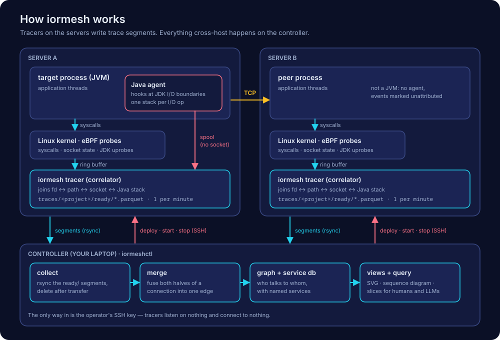
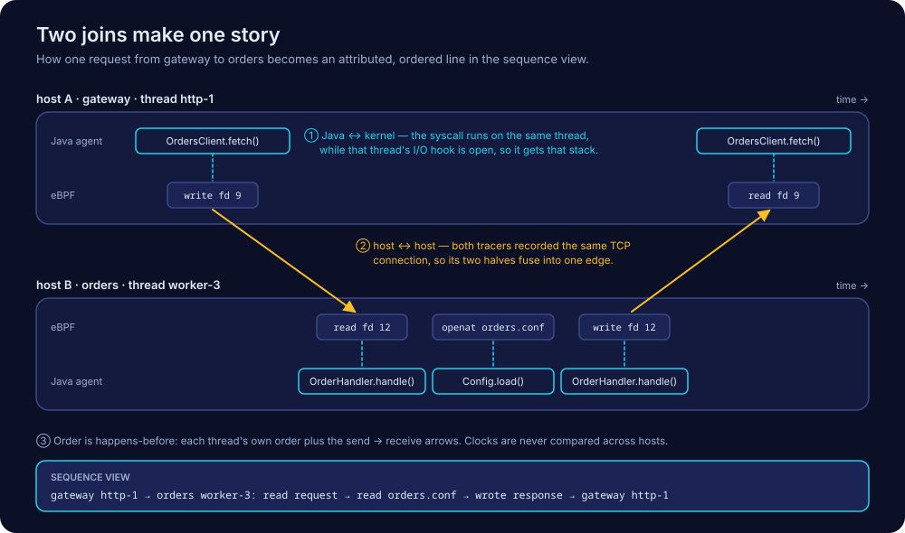
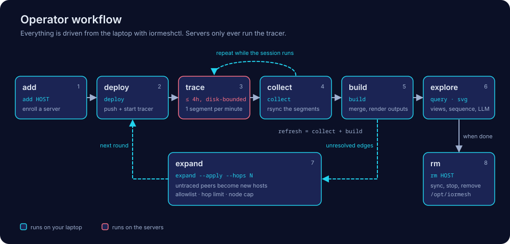

# 1. How iormesh works

iormesh answers one question across many hosts: *what does this
process touch, and what touches it back?* It maps every file and
socket a process uses, follows each connection across the wire to
the process on its other side, and names the Java code that drove
each call. The result is one graph you can read as a picture, as
text or as raw events.

## Two programs

- **`iormesh`, the tracer**, runs on every server you trace, as
  root. It is eBPF probes plus a correlator: the probes see the
  file and socket syscalls, the correlator joins each one to the
  Java stack of the thread that made it (through a small Java
  agent) and writes the result as trace segments on the host's
  disk. It listens on nothing, opens no connection and holds no
  credentials.
- **`iormeshctl`, the controller**, runs on your laptop (Linux or
  macOS), needs no eBPF and no root, and is a single pure-Go
  binary. It installs and starts tracers over SSH, pulls their
  segments home over rsync, merges them, and renders the mesh.

Nothing runs between the two except your SSH. There is no
collector service, no agent daemon, no open port: the mesh grows
only from the laptop, and only to hosts you listed.

## The words

| Word | Meaning |
|------|---------|
| **registry** | `~/.config/iormesh/servers.yaml` on the laptop: the hosts and pods iormeshctl may touch. Nothing outside it is ever contacted. |
| **project** | A label for what you trace on a host, plus its **target**: a `-pattern` glob over command lines, or a `-listen-port`. One host can carry several projects. |
| **session** | One run of the tracer for one project, on the host a transient systemd unit `iormesh-<project>.service`. It ends after its `-duration` (4h by default, 7 days at most). |
| **segment** | A minute of trace as one parquet file. The tracer writes to `/opt/iormesh/traces/<project>/` and moves a finished minute into `ready/`. |
| **store** | Where `collect` puts segments on the laptop: `~/.local/share/iormesh/traces/<project>/<host>/`. It only grows until you prune it. |
| **build** | The merge of the store into one graph, a view model, a rollup and a local site, under `~/.local/share/iormesh/builds/`. It never contacts a server. |
| **edge** | Who talks to whom. **Fused** when both ends were traced and joined into one cross-host edge; **unresolved** when only one end was. |
| **conversation** | One request entering the mesh and everything it caused, in order: requests, responses, and each serving thread's file work. |
| **ref** | A handle on one raw event, printed on every step; `iormeshctl query -ref REF` prints that event. |

Reference: [architecture.md](../architecture.md) (components),
[trace-scope.md](../trace-scope.md) (what is traced, and what is
not).

## What runs where

| On the laptop (`iormeshctl`) | On each host (`iormesh`, root) |
|---|---|
| keeps the registry, the pinned release key and the store | keeps one installed tracer in `/opt/iormesh/bin/` and its root-owned key |
| verifies a signed build before it leaves the laptop | verifies it again before it installs it |
| starts and stops sessions over SSH, through one sudoers rule | runs sessions as systemd units, writes segments |
| collects `ready/` segments over rsync | hands finished segments to `ready/` |
| merges, fuses edges, renders, answers queries | nothing of that: no host ever sees another's trace |

The sudoers rule lets your SSH user run exactly
`/opt/iormesh/bin/iormesh`, and the tracer only lets a few
subcommands through it (run, start, stop, status, upgrade,
uninstall). The first install needs your own sudo once
([chapter 4](04-register-bootstrap.md)); every later upgrade goes
through the rule.

Reference: [security.md](../security.md),
[decisions.md](../decisions.md) #1 (the install path) and #28
(signing).

## Two joins make the picture

On each host, a syscall is joined to the Java stack of the thread
that issued it. On the laptop, the two hosts' views of one TCP
connection are fused into a single edge. Order across hosts is
happens-before — each thread's own order plus send → receive —
never a comparison of two hosts' clocks. Every step of a
conversation says how its order is known: `causal`,
`time-ordered` (proved by the clocks' bounds) or `unordered`.

Reference: [output-contract.md](../output-contract.md) (why the
trace is built for reading by a human or an LLM),
[schema.md](../schema.md) (every field).

## The loop you will run

| Once | Chapter |
|---|---|
| make a release key, build and sign `dist/` | [3](03-release.md) |
| register each host and its projects (`add`) | [4](04-register-bootstrap.md) |
| install the tracer with your sudo (`bootstrap`) | [4](04-register-bootstrap.md) |

| Every round | Chapter |
|---|---|
| start sessions (`deploy`), check them (`status`) | [5](05-deploy-status.md) |
| fetch segments (`collect`), merge (`build`); `refresh` is both | [6](06-collect-build.md) |
| look (`show`, `open`, `tui`), dig (`query`) | [7](07-read-the-mesh.md), [8](08-java-query.md) |
| keep sessions alive (`ensure`), trim the store (`prune`) | [9](09-tracing-for-days.md) |
| follow unresolved edges (`expand`) | [10](10-expand.md) |
| stop and uninstall (`rm`) | [9](09-tracing-for-days.md#clean-up) |

`iormeshctl -h` prints the whole command list with a paragraph on
the defaults, and `iormeshctl <subcommand> -h` each subcommand's
flags.

---

[Contents](README.md) · Next: [2. Prepare the laptop and the hosts](02-prerequisites.md) →
