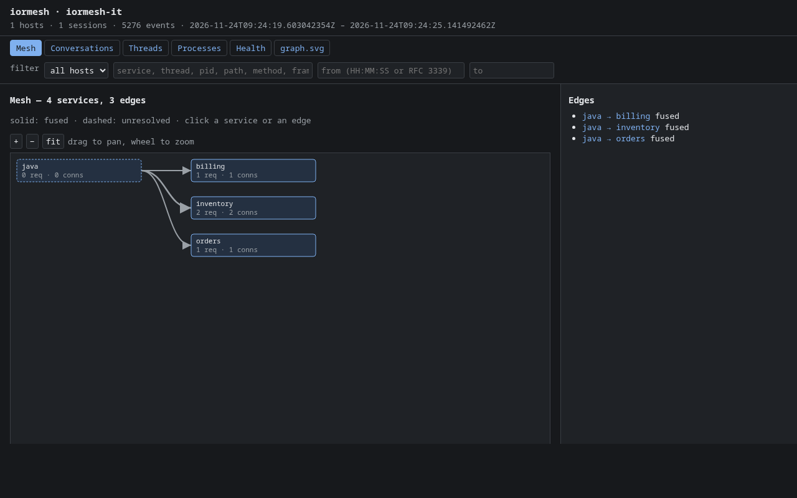
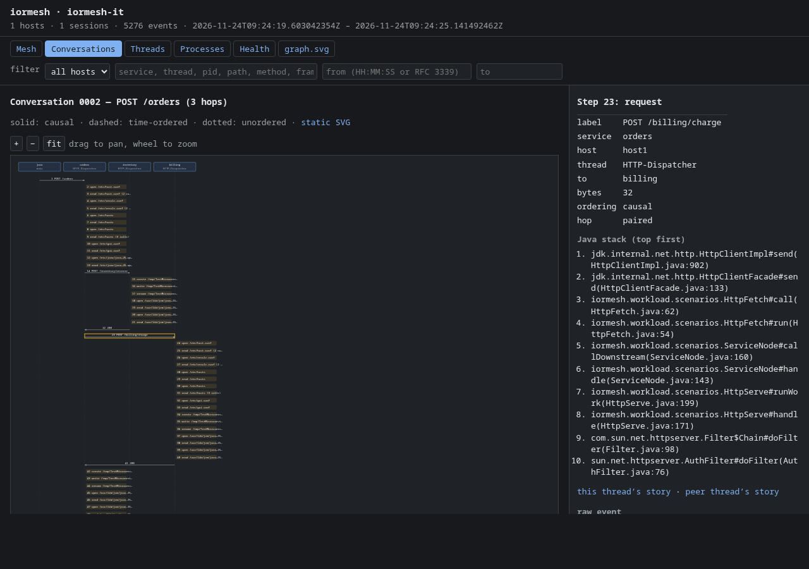
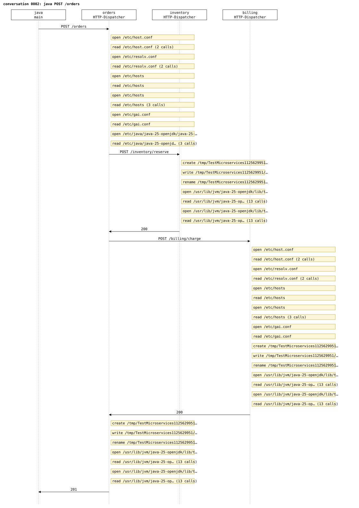

# 7. Read the mesh

Every build can be read three ways, all rendered from the same
view model, so they never disagree:

| Surface | Command | For |
|---------|---------|-----|
| Local site | `iormeshctl open` | exploring with a mouse: zoom, click, follow a connection |
| Terminal UI | `iormeshctl tui` | the same over SSH or without a browser |
| Plain text | `iormeshctl show [VIEW]` | reading, grepping, piping, pasting into a report |

This chapter walks all three on **a real trace**: the test
workload's microservices scenario (gateway → orders → inventory
and billing), four JVMs on one host's loopback under the tracer
and the Java agent, recorded by `TestMicroservices` with
`IORMESH_EVAL_EXPORT` set (what `mage evalTrace` does) on a Fedora
laptop, then built and shown with the `iormeshctl` of the same
commit (task wk4). Two edits were made for a public repository:
the laptop's host name reads `host1` and its machine id reads
`machine-id`. Nothing else was changed. The files are in
[examples/](../examples/):

| File | What |
|------|------|
| [site/index.html](../examples/site/index.html) | the build's whole site folder — download it and open it from `file://` to click through |
| [site/graph.svg](../examples/site/graph.svg) | the static overview export |
| [site/sequence/0002.svg](../examples/site/sequence/0002.svg) | the checkout conversation's static sequence diagram |
| [site-mesh.png](../examples/site-mesh.png), [site-sequence.png](../examples/site-sequence.png) | headless Chrome screenshots of the site |
| [show-sequence-0002.txt](../examples/show-sequence-0002.txt) | `show sequence 0002`, all 49 steps |
| [query-http.ndjson](../examples/query-http.ndjson) | `query -event http`: the run's eight http events |

The servers listen on free ports picked per run, so they were
named before the build, one rule per port
([chapter 6](06-collect-build.md#name-your-services)). Do the
same before you read your own mesh: until its servers are named,
`show edges` reads `java -> 127.0.0.1:18214@…` instead of `java
-> orders` (chapter 6's checkpoint). This run's rules:

```sh
iormeshctl services name -db DB -port 41331 '127.0.0.1*' orders
iormeshctl services name -db DB -port 36845 '127.0.0.1*' inventory
iormeshctl services name -db DB -port 34599 '127.0.0.1*' billing
iormeshctl build -store STORE -db DB -builds BUILDS
```

One thing to read correctly: the test traces its JVMs by pid,
with no `add -pattern` app, so every client is named by its
process name, `java`. The edges read `java -> orders`,
`java -> inventory` (two connections: the gateway's and orders')
and `java -> billing`, and the gateway, a client only, is the
service `java`. A deployment registered per app names each client
after its app.

## Plain text: `show`

`show` reads the newest build and prints one view. `-project`
picks the build of exactly that project set, `-json` prints the
view model's JSON instead of text. The views below were run for
this guide against this example's model.

The summary (`show`, or `show summary`; what `build` prints
before the paths):

```text
$ iormeshctl show
built      iormesh-it: 1 hosts, 1 sessions, 1 segments, 5276 events, 2026-11-24 09:24:19 - 2026-11-24 09:24:25 UTC
merged     4 services, 3 edges (3 fused, 0 mixed, 0 unresolved); tcp 0 fused, 0 unresolved
health     0 lost, 0 skipped runs, 0 unattributed, 0 attach gap; no clock bounds
sequence   2 conversations, 51 steps (0 time-ordered, 0 unordered)
```

Who serves what, who talks to whom, and the conversations:

```text
$ iormeshctl show services
SERVICE    NAMED  CONNS  UNRESOLVED  TLS    REQUESTS  ENDPOINTS
billing    yes    1      0           tls    1         127.0.0.1:34599@machine-id
inventory  yes    2      0           plain  2         127.0.0.1:36845@machine-id
java       no     0      0           -      0         -
orders     yes    1      0           tls    1         127.0.0.1:41331@machine-id
$ iormeshctl show edges
FROM  TO         STATE  CONNS  UNRESOLVED  FIRST                LAST
java  billing    fused  1      0           2026-11-24 09:24:23  2026-11-24 09:24:24
java  inventory  fused  2      0           2026-11-24 09:24:23  2026-11-24 09:24:24
java  orders     fused  1      0           2026-11-24 09:24:22  2026-11-24 09:24:24
$ iormeshctl show conversations
ID    START                    ENTRY  REQUEST                      HOPS  STEPS  SERVICES
0001  2026-11-24 09:24:24.371  java   GET /inventory/stock/widget  1     2      java inventory
0002  2026-11-24 09:24:22.477  java   POST /orders                 3     49     java orders inventory billing
```

`show edges -unresolved` lists only edges with an unresolved
connection. What the run could not see, and how each session
ended:

```text
$ iormeshctl show health
loss       0 lost, 0 skipped runs, 0 unattributed, 0 attach gap
session    iormesh-it/local host1 79d2d3d5: 1 segments, 5276 events, 2026-11-24 09:24:19 - 2026-11-24 09:24:25 UTC, end: targets_exited
```

### One conversation: `show sequence`

`show sequence ID` (the newest without an ID) prints a
conversation as numbered steps: ordering, actor
(`service/thread`), arrow, label, bytes and latency, then the
step's top Java frame and its `ref` (the whole stack: **The `at`
line is the top frame only**, below). The short one:

```text
$ iormeshctl show sequence 0001
conversation 0001  2026-11-24 09:24:24.371 UTC  java  GET /inventory/stock/widget  (1 hops)
services     java, inventory
lifeline 1   java/main  host1 pid 2484090@1353275890000000 tid 2484092
lifeline 2   inventory/HTTP-Dispatcher  host1 pid 2484011@1353274450000000 tid 2484398
  1  causal        java/main -> inventory/HTTP-Dispatcher: GET /inventory/stock/widget
                     at jdk.internal.net.http.HttpClientImpl#send(HttpClientImpl.java:902)
                     ref iormesh-it/local/host1-79d2d3d5/5223
  2  causal        inventory/HTTP-Dispatcher -> java/main: 200 [27 B, 21.317534ms]
                     at sun.net.httpserver.HttpExchangeImpl#close(HttpExchangeImpl.java:67)
                     ref iormesh-it/local/host1-79d2d3d5/5195
```

The checkout, `show sequence 0002`, cut to its hops and
inventory's record write (`…` marks the cuts; orders' resolver
and `net.properties` reads in steps 2–13, billing's work and the
later `tzdb.dat` reads are in the
[full text](../examples/show-sequence-0002.txt)):

```text
conversation 0002  2026-11-24 09:24:22.477 UTC  java  POST /orders  (3 hops)
services     java, orders, inventory, billing
lifeline 1   java/main  host1 pid 2484090@1353275890000000 tid 2484092
lifeline 2   orders/HTTP-Dispatcher  host1 pid 2484051@1353275280000000 tid 2484499
lifeline 3   inventory/HTTP-Dispatcher  host1 pid 2484011@1353274450000000 tid 2484398
lifeline 4   billing/HTTP-Dispatcher  host1 pid 2483913@1353273770000000 tid 2484384
  1  causal        java/main -> orders/HTTP-Dispatcher: POST /orders [36 B]
                     at jdk.internal.net.http.HttpClientImpl#send(HttpClientImpl.java:902)
                     ref iormesh-it/local/host1-79d2d3d5/5112
  2  causal        orders/HTTP-Dispatcher: open /etc/host.conf [15.676µs]
                     ref iormesh-it/local/host1-79d2d3d5/2730
  …
 14  causal        orders/HTTP-Dispatcher -> inventory/HTTP-Dispatcher: POST /inventory/reserve [36 B]
                     at jdk.internal.net.http.HttpClientImpl#send(HttpClientImpl.java:902)
                     ref iormesh-it/local/host1-79d2d3d5/3950
 15  causal        inventory/HTTP-Dispatcher: create /tmp/TestMicroservices1125629951/002/inventory.d/reservation-42.json.tmp [57.72µs]
                     at java.io.FileOutputStream#open(FileOutputStream.java:-1)
                     ref iormesh-it/local/host1-79d2d3d5/3724
 16  causal        inventory/HTTP-Dispatcher: write /tmp/TestMicroservices1125629951/002/inventory.d/reservation-42.json.tmp [36 B, 19.159µs]
                     at java.io.FileOutputStream#write(FileOutputStream.java:-1)
                     ref iormesh-it/local/host1-79d2d3d5/3726
 17  causal        inventory/HTTP-Dispatcher: rename /tmp/TestMicroservices1125629951/002/inventory.d/reservation-42.json.tmp -> /tmp/TestMicroservices1125629951/002/inventory.d/reservation-42.json [38.073µs]
  …
 22  causal        inventory/HTTP-Dispatcher -> orders/HTTP-Dispatcher: 200 [8 B, 313.527721ms]
                     at sun.net.httpserver.HttpExchangeImpl#close(HttpExchangeImpl.java:67)
                     ref iormesh-it/local/host1-79d2d3d5/3909
 23  causal        orders/HTTP-Dispatcher -> billing/HTTP-Dispatcher: POST /billing/charge [32 B]
                     at jdk.internal.net.http.HttpClientImpl#send(HttpClientImpl.java:902)
                     ref iormesh-it/local/host1-79d2d3d5/4838
  …
 48  causal        orders/HTTP-Dispatcher: read /usr/lib/jvm/java-25-openjdk/lib/tzdb.dat (13 calls) [104000 B, 58.136µs]
                     at java.io.FileInputStream#read(FileInputStream.java:-1) (first call)
                     ref iormesh-it/local/host1-79d2d3d5/5018 (first of 13)
                     last iormesh-it/local/host1-79d2d3d5/5042
                     run iormeshctl query -host host1 -thread 2484499 -file /usr/lib/jvm/java-25-openjdk/lib/tzdb.dat -from 2026-11-24T09:24:24.265135999Z -to 2026-11-24T09:24:24.267939918Z
 49  causal        orders/HTTP-Dispatcher -> java/main: 201 [33 B, 1.860686111s]
                     at sun.net.httpserver.HttpsExchangeImpl#close(HttpsExchangeImpl.java:67)
                     ref iormesh-it/local/host1-79d2d3d5/5052
```

How to read a step:

- **Ordering.** `causal`: the step follows the one before by
  thread order or a paired send → receive. `time-ordered`: no such
  edge, but the clocks (one host's, or two hosts' through their
  proved bounds) put it after. `unordered`: neither can tell.
  Raw timestamps of two hosts never order anything.
- **File work** sits on the serving thread's lifeline, in that
  thread's order between the calls it made: here inventory writes
  its reservation to a temporary file and renames it into place.
- **Folded runs.** Back-to-back repeats of one call by one thread
  are one step: `(13 calls)`, the sums of bytes and latency, the
  first call's frame and ref, and a `run` line with the query
  that prints every call.
- **A hop that is not `paired`** (a lost record, an untraced
  peer) is named on its step; such a step ends at its peer.
- **The `at` line is the top frame only**, most often a JDK I/O
  method (`java.io.FileOutputStream#write`). The application
  method that made the call sits further down the stack. The
  site's and the TUI's step detail print the stack (up to 12
  frames, below), and `show sequence ID -json` carries it on
  every step; `.steps[N-1]` is step N. Run for this guide
  against this example's model, inventory's write (step 16):

  ```text
  $ iormeshctl show sequence 0002 -json | jq '.steps[15] | {label, stack: .stack[:3]}'
  {
    "label": "write /tmp/TestMicroservices1125629951/002/inventory.d/reservation-42.json.tmp",
    "stack": [
      "java.io.FileOutputStream#write(FileOutputStream.java:-1)",
      "iormesh.workload.scenarios.DataStore#save(DataStore.java:34)",
      "iormesh.workload.scenarios.ServiceNode#handle(ServiceNode.java:144)"
    ]
  }
  ```

  The first frame outside the JDK, `DataStore#save`, is the
  code behind the step. `query -ref` prints the raw event, whose
  stack holds method ids, not frames (`-frames` adds them by
  name); `query -method` goes the other way, from a method to its
  events
  ([chapter 8](08-java-query.md#from-a-step-to-its-raw-events-query)).

### More views

| Command | Shows |
|---|---|
| `show thread` | every thread lifeline with its step count |
| `show thread orders/HTTP-Dispatcher` | that thread's story as one line, then entry by entry |
| `show processes` | per process: threads, files (bytes read and written, renames), sockets with their peers |
| `show report` | the summary, then the per-run rollup from `report.json` |

The thread story, run for this guide (cut after its first
entries):

```text
$ iormeshctl show thread orders/HTTP-Dispatcher
thread       orders/HTTP-Dispatcher  host1 pid 2484051@1353275280000000 tid 2484499
story        received POST /orders from java => open /etc/host.conf => read /etc/host.conf (2 calls) => … => sent POST /inventory/reserve to inventory => got 200 from inventory => sent POST /billing/charge to billing => got 200 from billing => create /tmp/TestMicroservices1125629951/002/orders.d/order-42.json.tmp => write … => rename … -> /tmp/TestMicroservices1125629951/002/orders.d/order-42.json => … => replied 201 to java
  1  time-ordered  0002#1  received POST /orders from java
                     ref iormesh-it/local/host1-79d2d3d5/5112
  2  causal        0002#2  open /etc/host.conf
                     ref iormesh-it/local/host1-79d2d3d5/2730
```

Reference: [visualization.md](../visualization/renderers.md#plain-text)
(every view, its caps and rules).

## The local site: `open`

```sh
iormeshctl open
```

`open` prints the newest site's path and opens it with `xdg-open`
(`open` on macOS); over SSH or without a browser, the printed path
is the answer; `$BUILDS/<projects>/sites/latest` links the newest
run's folder. The site is one self-contained `index.html` that
loads nothing from the network, so it works from `file://` and
can be copied to a colleague with the folder.

The mesh screen (`#/mesh`) and the checkout's sequence with step
23, orders calling billing, open in the detail panel
(`#/conv/0002/step/23`; the Java stack is the one the agent
recorded):





Click a service for its endpoints, paths, edges and
conversations; click an edge to follow a connection to its other
side, across hosts; click a step for its Java stack and the
`iormeshctl query -ref …` command that prints the raw event. The
URL hash is the view, so a link to one step can be shared with
someone who has the same folder. The static export of the same
conversation, lifelines left to right, file work as notes:



Reference: [visualization.md](../visualization/renderers.md#the-local-site)
(screens, the filter bar, deep links, the CSP).

## The terminal UI: `tui`

```sh
iormeshctl tui
```

It needs a terminal on stdin and stdout; without one it exits 1
and points at `show`. Keys: `1`–`7` the screens (services, edges,
conversations, sequence, threads, processes, health), `↑↓` move,
`⏎` open (a service or edge opens its conversations, a
conversation its sequence, a step its thread's story), `esc` back,
`tab` into the detail pane, `/` filter, `?` help, `q` quit.

The example in a 120×28 terminal (tmux `capture-pane`; the colours
are lost), the services screen with orders selected, blank rows
cut:

```text
iormesh · iormesh-it · 2026-11-24 09:24:19 – 09:24:25 UTC · 4 services · 3 edges · 2 conversations
 1 services  2 edges  3 conversations  4 sequence  5 threads  6 processes  7 health
 SERVICE    CONNS  REQS  TLS                    │service    orders  named by a rule
 billing    1      1     tls                    │endpoints  127.0.0.1:41331@machine-id
 inventory  2      2     plain                  │conns      1 (0 unresolved), TLS tls
 java       0      0     -                      │requests   1
 orders     1      1     tls                    │  POST   /orders  1
                                                │called by  java (fused, 1 conns)
                                                │
                                                │conversations (newest first; ⏎ lists them all)
                                                │  0002  09:24:22.477  POST /orders  3 hops
↑↓ move · ⏎ open · esc back · tab detail · / filter · 1-7 screens · ? help · q quit
```

`3`, the checkout, `⏎`, then down to step 17 — inventory renames
its reservation into place, and the stack shows which code did:

```text
iormesh · iormesh-it · 2026-11-24 09:24:19 – 09:24:25 UTC · 4 services · 3 edges · 2 conversations
 1 services  2 edges  3 conversations  4 sequence  5 threads  6 processes  7 health
 #   ORDERING  STEP 0002 POST /orders           │step       17 of conversation 0002 (file)
 1   causal    java/main -> orders/HTTP-Dispatc…│what       rename
 2   causal    orders/HTTP-Dispatcher: open /et…│/tmp/TestMicroservices1125629951/002/inventory.d/reservation-
 3   causal    orders/HTTP-Dispatcher: read /et…│42.json.tmp ->
 4   causal    orders/HTTP-Dispatcher: open /et…│/tmp/TestMicroservices1125629951/002/inventory.d/reservation-42.json
 5   causal    orders/HTTP-Dispatcher: read /et…│on         inventory/HTTP-Dispatcher  host1 pid
 6   causal    orders/HTTP-Dispatcher: open /et…│2484011@1353274450000000 tid 2484398
 7   causal    orders/HTTP-Dispatcher: read /et…│ordering   causal (thread order or a paired send -> receive)
 8   causal    orders/HTTP-Dispatcher: open /et…│latency    38.073µs
 9   causal    orders/HTTP-Dispatcher: read /et…│java stack (top first)
 10  causal    orders/HTTP-Dispatcher: open /et…│  at sun.nio.fs.UnixNativeDispatcher#rename(UnixNativeDispatcher.java:-
 11  causal    orders/HTTP-Dispatcher: read /et…│1)
 12  causal    orders/HTTP-Dispatcher: open /et…│  at sun.nio.fs.UnixFileSystem#move(UnixFileSystem.java:815)
 13  causal    orders/HTTP-Dispatcher: read /et…│  at
 14  causal    orders/HTTP-Dispatcher -> invent…│sun.nio.fs.UnixFileSystemProvider#move(UnixFileSystemProvider.java:289)
 15  causal    inventory/HTTP-Dispatcher: creat…│  at java.nio.file.Files#move(Files.java:1319)
 16  causal    inventory/HTTP-Dispatcher: write…│  at iormesh.workload.scenarios.DataStore#save(DataStore.java:38)
 17  causal    inventory/HTTP-Dispatcher: renam…│  at
 18  causal    inventory/HTTP-Dispatcher: open …│iormesh.workload.scenarios.ServiceNode#handle(ServiceNode.java:144)
 19  causal    inventory/HTTP-Dispatcher: read …│  at iormesh.workload.scenarios.HttpServe#runWork(HttpServe.java:199)
 20  causal    inventory/HTTP-Dispatcher: open …│  at iormesh.workload.scenarios.HttpServe#handle(HttpServe.java:171)
 21  causal    inventory/HTTP-Dispatcher: read …│  at com.sun.net.httpserver.Filter$Chain#doFilter(Filter.java:98)
 22  causal    inventory/HTTP-Dispatcher -> ord…│  at sun.net.httpserver.AuthFilter#doFilter(AuthFilter.java:76)
 23  causal    orders/HTTP-Dispatcher -> billin…│ref        iormesh-it/local/host1-79d2d3d5/3729
 24  causal    billing/HTTP-Dispatcher: open /e…│raw event  iormeshctl query -ref iormesh-it/local/host1-79d2d3d5/3729
↑↓ move · ⏎ open · esc back · tab detail · / filter · 1-7 screens · ? help · q quit
```

Reference: [visualization.md](../visualization/renderers.md#the-terminal-ui)
(the screens and their rules).

**If not:** `show: no build of … yet (iormeshctl build…)` and
`open: no site of … yet (iormeshctl build)` mean there is no build
of that project set: `show -project` and `open -project` read the
build made with the same `-project` set. On a fresh laptop they
answer `trace store: open …/traces: no such file or directory`
(run for this guide): collect and build first. A build without
http events (no Java agent, [chapter 8](08-java-query.md)) has no
conversations: `show sequence` answers `show: no such
conversation: the build holds none (no http events)` and exits 1,
`show conversations` and `show thread` print only their header,
while `show services`, `edges`, `processes` and `report` still
read the build (run on Rocky 9.9, task 4k4). `tui` without a
terminal exits 1 with `tui needs a terminal on stdin and stdout;
for text use iormeshctl show (it pipes)`.

---

← [6. Collect and build](06-collect-build.md) · [Contents](README.md) · Next: [8. Java code flow and query](08-java-query.md) →
