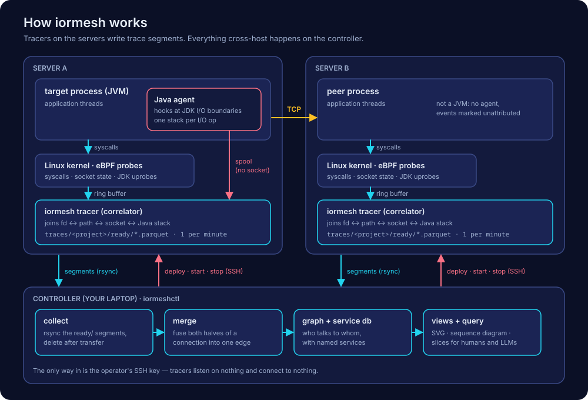

# The iormesh guide

A step-by-step guide to iormesh, from an empty laptop to a mesh of
two traced hosts you can click through, query and keep running for
days. Each chapter does one real thing with the real commands and
shows what success looks like and what to do when it does not.
Each chapter ends with links into the detailed docs, which keep
every option and every sharp edge.

The guide is written so a human can follow it alone, or an LLM
agent can drive it together with a human: steps only a human can
do (a sudo password, a passphrase, a host key fingerprint, a yes
to a change on a production host) are marked **Human step**, and
every step has a checkpoint. [Chapter 13](13-agents.md) is the
agent's own chapter.

## Chapters

| # | Chapter | You learn |
|---|---------|-----------|
| 1 | [How iormesh works](01-how-iormesh-works.md) | Tracer, controller, registry, project, session, segment, store, build, fused edge; what runs where |
| 2 | [Prepare the laptop and the hosts](02-prerequisites.md) | What the controller and each Rocky 9.9 host need, and how to check it |
| 3 | [Get and sign a release](03-release.md) | Your key, a release or `dist/`, `sha256sum -c`, `iormeshctl sign`, `iormeshctl verify` |
| 4 | [Register hosts and bootstrap them](04-register-bootstrap.md) | `add`, `list`, `-pattern` and `-listen-port`, the one-time `bootstrap` |
| 5 | [Deploy and check status](05-deploy-status.md) | `deploy`, `status`, the session unit on the host |
| 6 | [Collect and build](06-collect-build.md) | `collect`, `build`, `refresh`, the store, naming services |
| 7 | [Read the mesh](07-read-the-mesh.md) | `show` and its views, the local site, the TUI, on a real trace |
| 8 | [Java code flow and query](08-java-query.md) | The Java agent, stacks on every step, `query` and refs |
| 9 | [Tracing for days](09-tracing-for-days.md) | `ensure` from a timer, windowed builds, `prune`, `rm` |
| 10 | [Grow the mesh](10-expand.md) | `expand`: follow unresolved edges to untraced peers |
| 11 | [Kubernetes](11-kubernetes.md) | Pods as hosts, debug or sidecar, the path through the runbook |
| 12 | [When things go wrong](12-troubleshooting.md) | Reading errors, where the logs are, the lookup table |
| 13 | [For agents working with a human](13-agents.md) | Who does what, checkpoints, safe commands, trace data stays local |

## How to follow along

Chapters 2–9 are one path: do them in order the first time.
Chapters 10–12 are for when you need them, and chapter 13 is for
an agent (and the human it works with) before they start.

The example names, used throughout: the laptop is the
**controller**; hosts `app1` and `app2` run Rocky Linux 9.9 with
the SSH user `ops`; project `shop` is a Java service on `app1`,
project `billing` is whatever listens on TCP 8443 on `app2`.
Substitute your own.

Outputs come from three places, and each one says which:

- **Run for this guide** — `iormeshctl` built from this tree and
  run on a laptop against a scratch registry and store, or against
  the signed `dist/` already on it. Paths there are shortened to
  `~`, and keys and hashes cut to `…`.
- **A real trace** — the build in [examples/](../examples/): the
  test workload's microservices scenario, four JVMs on one host
  under the tracer and the Java agent (task wk4).
- **A test golden** — a file in `internal/ctl/testdata/` the test
  suite compares the program's real output against.

Commands that contact a host (`bootstrap -apply`, `deploy`,
`status`, `collect`, `ensure`, `rm`) were **not** run for this
guide; for them it shows the shape of the output as the source
prints it, never invented numbers. The M4 acceptance on two Rocky
9.9 VMs ([testing.md](../testing/m4-acceptance.md#m4-acceptance-on-two-real-hosts-task-lb4))
ran the same `add`, `deploy`, `collect`, `refresh`, `build`,
`show` and `rm` path. Every flag in the guide was checked against
`iormeshctl <subcommand> -h`; when yours reads differently, `-h`
is right.

A line `[exit status 1]` under an output marks how the command
exited; the command does not print it.
