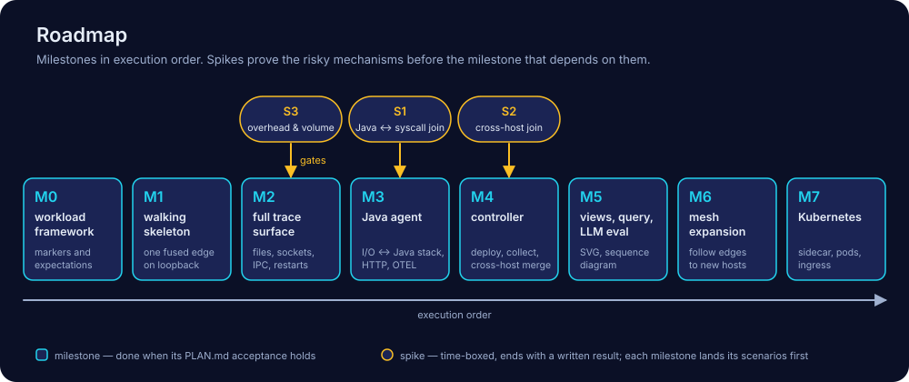

# Implementation guide

Step-by-step work packages with code sketches, for whoever — human
or agent — picks up a spike or milestone. Companion to
[milestones.md](milestones.md) and [decisions.md](decisions.md):
they decide *what* and *in which order*; this guide shows *how*.

Read this first:

- **The decisions win.** Where a sketch here disagrees with
  decisions.md or milestones.md, they are right and this file
  needs fixing in the same commit.
- **ior wins on mechanics.** Sketches are written against `../ior`
  as it looked on 2026-11-17. ior moves; when a sketch and ior's
  current code disagree, follow ior and update the sketch.
- **Sketches are sketches.** They fix names, shapes and the order
  of work so two agents build the same thing. They are not
  compiled, not complete, and items marked *hypothesis* are
  exactly that — a spike confirms or replaces them.
- **Nothing is scaffolded ahead of time** (AGENTS.md). Create a
  package when its work package starts, not before.

## Parts

This file is the index: each part below is its own file. Read the summaries,
then open only the part you need.

- [Ground rules](implementation/ground-rules.md) — what every work package
  follows, and the cgo boundary.
  - [The cgo boundary](implementation/ground-rules.md#the-cgo-boundary)
- [Shared building blocks](implementation/shared-building-blocks.md) — the
  event envelope, the graph and the golden-expectation format every milestone
  reuses.
  - [The event
    envelope](implementation/shared-building-blocks.md#the-event-envelope)
  - [The graph](implementation/shared-building-blocks.md#the-graph)
  - [Expectations (the golden
    format)](implementation/shared-building-blocks.md#expectations-the-golden-format)
- [M0 — workload framework](implementation/m0.md) — the Java test workload and
  its scenario framework.
- [M1 — walking skeleton](implementation/m1.md) — steps 1–11: ior build, attach
  set, target map, 4-tuples, loader, correlator, NDJSON, normalizer, golden
  check, CLI, harness.
- [S3 — overhead and volume budget](implementation/s3.md) — the overhead spike.
- [M2 — full trace surface](implementation/m2.md) — process tree to budget,
  steps 1–11.
  - [M2 steps 1–3: process tree, target spec, app
    identity](implementation/m2/steps-1-3.md) — exec/fork tracking, the target
    spec, app identity.
  - [M2 steps 4–7: files, paths, fd lifecycle,
    IPC](implementation/m2/steps-4-7.md) — the file surface, rename-aware
    paths, fd lifecycle, IPC/signals/UDP/epoll.
  - [M2 steps 8–11: redaction, native stacks, non-Java peer,
    budget](implementation/m2/steps-8-11.md) — redaction, native stacks, the
    non-Java peer, the S3 budget work.
- [S1 — Java↔syscall join](implementation/s1.md) — the Java join spike.
- [M3 — Java agent](implementation/m3.md) — the agent jar, the ring, the join,
  HTTP hooks, OTEL, live attach.
  - [M3 steps 1–4: build, install, hook table,
    ring](implementation/m3/steps-1-4.md) — agent build and install, the hook
    table, the per-JVM ring.
  - [M3 steps 5–6: the join, method and thread
    tables](implementation/m3/steps-5-6.md) — joining the agent bracket to the
    syscall; method and thread tables.
  - [M3 step 7: HTTP hooks](implementation/m3/step-7.md) — one transformer per
    HTTP library.
  - [M3 steps 8–10: OTEL, scenarios, live
    attach](implementation/m3/steps-8-10.md) — span context, the method-flow
    scenarios, live attach.
- [S2 — cross-host join](implementation/s2.md) — the cross-host join spike and
  its netns rig.
- [M4 — controller](implementation/m4.md) — tracer side, controller side, the
  merge, service database, build/show, window and prune.
  - [Tracer side](implementation/m4/tracer-side.md) — segments, the unit, the
    sudoers-gated tracer CLI.
  - [Controller side](implementation/m4/controller-side.md) — registry,
    bootstrap, deploy, start/stop, status, collect, rm.
  - [The merge](implementation/m4/merge.md) — merging collected segments, clock
    reconciliation.
  - [Service database](implementation/m4/service-database.md) — the
    service-interaction database.
  - [Build, refresh and show](implementation/m4/build-refresh-show.md) — the
    build, refresh and show commands.
  - [Build window and prune (task
    yh4)](implementation/m4/build-window-prune.md) — windowed builds and
    pruning (task yh4).
  - [M4 scenarios](implementation/m4/scenarios.md) — the microservices
    scenario, the two-host and NAT'ed pairs.
- [M5 — views, query, eval](implementation/m5.md) — determinism, conversations,
  threads, site, TUI, query, summary rollup, eval.
- [M6 — mesh expansion](implementation/m6.md) — controller-driven expansion.
- [M7 — Kubernetes](implementation/m7.md) — tracer in a pod, cgroups and the
  image, k8s transport and registry, ClusterIP join and route map.
  - [M7 steps 1–5: the tracer in a pod](implementation/m7/steps-1-5.md) —
    PID-namespace targeting, memlock, Java staging, the mark, prepared pods.
  - [M7 steps 6–8: cgroups, pod names, the
    image](implementation/m7/steps-6-8.md) — cgroup → pod, pod names, the image
    and its security context.
  - [M7 steps 9–10: transport and registry](implementation/m7/steps-9-10.md) —
    the k8s transport, the k8s:/pods: registry sections.
  - [M7 steps 11–13: ClusterIP join, route map, routed
    edges](implementation/m7/steps-11-13.md) — the ClusterIP join,
    internal/routemap, rendering routed edges.
