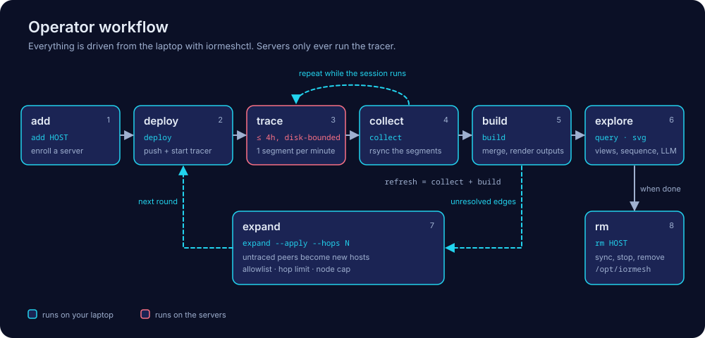

# M4 — controller

Part of [Implementation guide](../implementation.md).

**Goal**: `add` → `deploy` → `refresh` → `rm`, merge on the
laptop. `collect` and `build` are separate commands — sync only,
and offline build only — and `refresh` is the two in a row;
keep them separate in code too (`collect.go` never imports the
merge). milestones.md: "M4 — Controller".

## Parts

Each part is its own file; open only the one you need.

- [Tracer side](m4/tracer-side.md) — segments, the unit, the
  sudoers-gated tracer CLI.
- [Controller side](m4/controller-side.md) — registry,
  bootstrap, deploy, start/stop, status, collect, rm.
- [The merge](m4/merge.md) — merging collected segments, clock
  reconciliation.
- [Service database](m4/service-database.md) — the
  service-interaction database.
- [Build, refresh and show](m4/build-refresh-show.md) — the
  build, refresh and show commands.
- [Build window and prune (task yh4)](m4/build-window-prune.md)
  — windowed builds and pruning (task yh4).
- [M4 scenarios](m4/scenarios.md) — the microservices scenario,
  the two-host and NAT'ed pairs.
