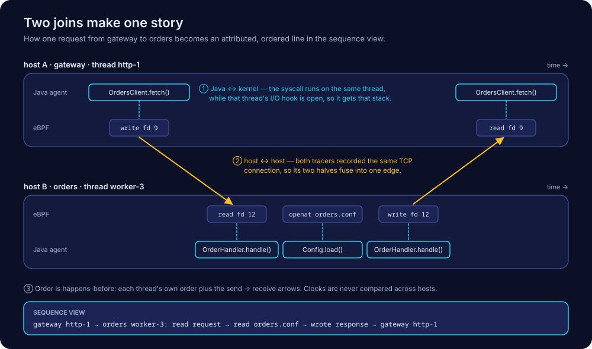

# M5 — views, query, eval

Part of [Implementation guide](../implementation.md).

The three surfaces — local site, terminal UI, plain text — and
the view model they share are designed in
[visualization.md](../visualization.md), including the build order
(V1 lands with M4, V2–V4 here). V1 is built (task ib4, M4
"Build, refresh and show"): `internal/viewmodel` with run,
health, services and edges, and its text views. Extend the model
and its goldens first (conversations and processes, V2); a
renderer never reads the merged graph directly — `graph.svg`, a
drawing of the graph export itself, is the one exception (milestones.md
M5 "Deterministic SVG export"), and even it takes its names from
the model (`render.NamesOf`: hosts by store name, servers by the
service they serve, task rb4). Conversations are built (task
mb4, "Conversations and exports" below), per-thread lifelines,
thread stories and processes too (task 0f4, "Threads and
processes"), and the local site (task nb4, "Local site").



**Determinism rules** for everything in `internal/render` — a
test renders each golden twice and compares bytes:

- input is a *normalized* graph; iterate only over sorted slices;
- layout is a pure function of the sorted order — no force
  simulation, no randomness, no clock;
- coordinates are integers; where division is needed, round once
  and format with `strconv.Itoa`;
- no timestamps, hostnames of the rendering machine, or version
  strings in the output;
- escape all text through one function.

```go
// Layout assigns positions purely from the graph's sorted order:
// hosts become columns, node types become rows within a host.
func Layout(g schema.Graph) Placed

// SVG serializes a layout. Same Placed in, same bytes out.
func SVG(p Placed) []byte

// Sequence renders one conversation of the view model: one
// lifeline per service, one arrow per request and response, file
// ops as notes on the lifeline of the thread that did them.
func Sequence(c viewmodel.Conversation) []byte
```

**Conversations and exports** — V2, built by task mb4 (cgo-free;
the model, its rules and the views in
[visualization.md](../visualization.md), "V2 as built"):

```
internal/viewmodel/conversation.go # Conversation, Step, caps, Order*/Hop*
internal/viewmodel/record.go       # Recorder: the http pass, Plan
internal/viewmodel/link.go         # pair by req_seq, by clock; nest
internal/viewmodel/fileops.go      # the file pass, fd → path, Methods
internal/viewmodel/steps.go        # the steps, depth first; ordering
internal/viewmodel/names.go        # lifelines named as servicedb does
internal/viewmodel/sequence.go     # show conversations, show sequence
internal/render/                   # Graph, Sequence: the SVG exports
internal/ctl/conversations.go      # the passes and the frames in build
internal/query/                    # + Filter.Ref, ParseRef (-ref)
```

- **Passes.** The http events ride along with `servicedb.Observe`'s
  read (`recordedSegment`, conn ids renamed by the merge); `Plan`
  keeps the newest 2¹⁸ of them (sorted and cut whenever twice that
  piled up, so memory stays bounded and the kept set is the one a
  single sort would keep), links them and picks the 100 newest
  roots. Only then is the store read once more, for the file work
  of the threads that served a kept request (and the fd → path
  table of their processes), and each methods table holding a
  kept step's frame once — checked in the memory-capped child
  like a segment; a table that fails joins the bad segments and
  its frames stay `method#<id>`.
- **Linking** is per request, never per guess: the req_seq pair
  must be unique on both ends; nesting needs both spans owned by
  the thread (`http.held` from the agent's HTTP flag 16, set by
  the synchronous libraries and never by Netty; a platform thread
  known by name — the correlator now names a virtual thread's
  request `carrier` as it does a syscall's) and looks at the 8
  latest server requests of the thread starting no later; the
  clock join compares at most 64×64 unpaired requests of one
  connection, skips a connection with a startless unpaired end,
  and takes a mutual unique match only; past the 2¹⁸ cut a
  request starting before the oldest kept completion plus the
  widest clock offset joins nothing (`Recorder.edge`). What a rule cannot prove
  stays apart, and says so (`hop`, `ordering`).
- **Exports.** `build` writes `graph.svg` atomically and the
  `sequence/` directory whole under a temporary name, swapped in,
  so a conversation of an earlier build never lingers next to the
  new ones. Text goes through one escape (`esc`: `termsafe.String`,
  then the XML specials).
- Tests: `internal/viewmodel/conversation_test.go` (ordering
  across hosts with a known skew — proven, within the bound's
  width, raw-later-but-earlier, no bound, outside the window;
  clock join proven, too wide, no bound, two candidates; an
  unordered step; duplicate req_seq, carrier, async, outside the
  span; a startless end on a clock-joined connection; file work;
  caps; escapes), `guard_test.go` (a Netty loop's overlapping
  requests, two virtual threads on one carrier and an unknown
  thread nest nothing and own no file work; no join near the
  cut), `fold_test.go` (task vg4: the Rocky 9.9 checkout's noise
  pattern, trimmed — runs of `lib/modules` reads, the
  name-service lookup, `/dev/urandom` breaking a run — keeps
  every hop and each create-tmp/write/rename inside the cap, the
  folded steps' calls and bytes adding up to every event; no run
  across a call; a failed and a successful open, or two Java
  thread names, kept apart; the step after a run judged by its
  last call; services named past the cap; calls cut past a
  request's cap counted as runs, never folded into a kept step;
  the run query escaped and quoted, and `show sequence` marking a
  run's first-call fields), `internal/tui/fold_test.go` (the step
  detail's run labels), the site selftest (the same labels in the
  browser);
  `internal/correlate/javahttp_thread_test.go` (a virtual
  thread's http event `carrier` under its carrier's name, held
  only with a start, a lost thread record unnamed);
  `internal/render/render_test.go` (two renders byte-identical,
  well-formed XML, no raw control character, a class from the
  data written as `other`, the column cap); `internal/ctl/conversations_test.go`
  — a four-host store (gateway → orders → inventory and billing,
  billing's clock 30 ms ahead, the billing hop HTTP/2): the list,
  the sequence text and JSON, `sequence/0001.svg` and `graph.svg`
  against `testdata/conv_*.golden`, byte-identical rebuilds; the
  same store without the billing connection's data records (no
  bound: the hop unpaired, billing's request its own
  conversation); `query -ref` of the rename step.

**Threads and processes** — the rest of V2, built by task 0f4
(cgo-free; the model and views in
[visualization.md](../visualization.md), "V2 as built"):

```
internal/viewmodel/conversation.go # + Lifeline, Step.Lane/ToLane
internal/viewmodel/steps.go        # each step's two ends (end), lanes
internal/viewmodel/stories.go      # ThreadStory, storyBook, storyOrder
internal/viewmodel/process.go      # Process: projected from report
internal/viewmodel/threadview.go   # show thread [SERVICE/THREAD]
internal/viewmodel/processview.go  # show processes
internal/render/sequence.go        # one column per lifeline
internal/report/                   # + Thread.Carried, Call.Carrier
```

- **No new pass.** The emitter that writes a conversation's steps
  knows each step's two threads and their instants on their own
  hosts' clocks; it files both ends in the conversation's
  lifelines and in a story book shared across the conversations.
  The processes come from the rollup `build` already collects
  (`viewmodel.Input.Report`), which now counts a carrier thread's
  virtual-thread events (`carried`) and flags their calls.
- **Lifeline identity** is service, host, pid, pid incarnation,
  tid, thread name and the carrier flag: a virtual thread's I/O on
  a carrier and the carrier's own work are two lifelines, and two
  threads of one name — or a restarted process's thread reusing
  pid and tid — stay apart.
- **Story order** is per lifeline, by its own host's clock and then
  emission order; `storyOrder` judges each entry against the one
  before (causal inside one owned span, else time-ordered when the
  clock moved on, else unordered); every entry of a carrier's
  lifeline is unordered (virtual threads migrate, review of task
  0f4), and its text has no one-line story. A step past
  `MaxSteps` counts in its lifelines' `more_entries`, as do
  entries past 200.
- **Renderer**: `render.Sequence` heads each column with service and
  thread (class `carrier`, dashed, for a carrier's lifeline); a lane
  index outside the list is not drawn but counted ("N steps with
  invalid lanes not drawn"), and a model without lifelines (built
  before) is drawn one column per service.
- Tests: `internal/viewmodel/lifeline_test.go` (a virtual thread's
  requests on their own lifelines beside the carrier's own, two
  interleaved ones' story all unordered with no one-line chain; two
  incarnations of one pid and tid two stories; story ordering ties
  and spans; the entry cap; the processes projection —
  incarnations, carried counts, a self-connection's two ends by fd,
  escapes, no rollup; thread views terminal-safe, unknown thread);
  `internal/render/render_test.go` (columns per lifeline, the
  carrier lane, out-of-range lanes not drawn and counted); `internal/report`
  (`TestReportCarrier`); `internal/ctl/threads_test.go` — the
  four-host store's `show thread`, `show thread
  orders:8080/worker-3` (one owned span: every entry after the
  first causal) and `show processes` against
  `testdata/{thread_list,thread_story,processes}.golden`, an unknown
  thread; the conversation goldens gained the lifelines.

**Local site** — V3, built by task nb4 (cgo-free; the design and
the screens in [visualization.md](../visualization.md), "The local
site" and "V3 as built"):

```
internal/site/site.go          # Files, RunName, Write, Latest
internal/site/page.go          # Page: CSP hashes, model JSON block
internal/site/assets/app.js    # the explorer, hand-written, no deps
internal/site/assets/site.css  # its stylesheet (light and dark)
internal/ctl/build.go          # build writes sites/, prints site
internal/ctl/open.go           # iormeshctl open, xdg-open / open
```

- **One page, nothing loaded.** `Page` inlines the stylesheet,
  the script and the model; the CSP lists the sha256 of the
  exact inline script and stylesheet text, so editing either
  changes the hash with it. The model goes in through
  `json.Encoder` with `SetEscapeHTML(true)`, and `Page` refuses a
  block holding a raw `<`, `>`, `&`, U+2028 or U+2029.
- **The script** reads the block with `textContent`, renders by
  `createElement`/`createElementNS` and text nodes only, routes by
  the URL hash, and draws the mesh and sequence SVGs from the
  model with the export's rules (layout a function of the sorted
  model). `#/selftest` renders every route for the browser check.
- **Folders**: `Write` renders the files, names the folder
  `Run.Last` (`20060102T150405Z`) plus 12 hex digits of a hash of
  the files, writes it under a temporary name, renames it into
  place (replacing a same-named folder, whose content is the
  same) and swaps `latest` by renaming a fresh symlink over it.
  Older folders are never touched.
- **open** resolves the projects like `show`, follows `latest`
  only to a folder directly under `sites/`, prints `site  PATH`,
  then starts the opener without waiting; no opener on `PATH` is
  no error.
- Tests: `internal/site/site_test.go` (deterministic renders and
  names, CSP, no network, hostile strings, runs kept, `latest`
  escapes), `browser_test.go` (opt-in headless Chrome,
  [testing.md](../testing.md) "Local site"),
  `internal/ctl/open_test.go` (build → open, rebuild same folder,
  changed data a new one, the page's model equals `model.json`);
  `build_summary.golden` gained the `site` line (folder name
  masked).

**Terminal UI** — V4, built by task ob4 (cgo-free; screens and
keys in [visualization.md](../visualization.md), "V4 as built"):

```
internal/tui/tui.go        # Model (all-pointer), New, Run, Init, Update, View
internal/tui/screens.go    # each screen's rows, scope, text filter
internal/tui/detail.go     # the detail pane: show's text, step detail
internal/tui/keys.go       # keys, the ⏎/esc walk, filter editing
internal/tui/view.go       # layout, fit to the terminal, styles
internal/ctl/tui.go        # iormeshctl tui: TTY check, loadModel
internal/viewmodel/safe.go # + Safe; StepText, ActText,
                           #   LifelineDetail, WriteProcess exported
```

- **One data path.** `tui` loads `model.json` with `show`'s
  `loadModel` and hands it to `tui.New`, which keeps
  `viewmodel.Safe(m)`: every string a server chose is
  terminal-safe before any screen formats it. Rows and details
  reuse the text views (`StepText`, `WriteSequence`,
  `WriteThreads`, `WriteProcess`, `WriteSummary`, `WriteHealth`),
  so the TUI and `show` read alike. The model is bounded, so rows
  are rebuilt per frame — no cache to fall out of step.
- **Frames.** `Render` is a pure function of the model, the size
  and the keys: title, tab bar, body, footer — from the 20×6
  minimum up exactly the terminal's size (below it, one line
  saying it is too small); `fit` cuts each line with `ansi.Truncate`
  (escape- and width-aware) and pads it; details wrap with
  `ansi.Wrap`. Styles (Lip Gloss) are applied after the cut,
  only to safe text. `Init` asks for nothing; the size arrives as
  a `WindowSizeMsg`; `clamp` keeps cursor, list offset and detail
  scroll in range after every message.
- **No terminal.** `env.terminal` (stdin and stdout both a TTY,
  `golang.org/x/term`) gates the command before anything is
  read; tests fake it and `env.tui`.
- Tests: `internal/tui/tui_test.go` — every screen at eight sizes
  (below the minimum, stacked, both sides of the 100-column
  split, wide) with the cursor on every row, the detail focused
  and the help open: each frame exactly the height, each line
  exactly the width; names, threads, paths and frames holding
  `ESC[2J` never reach the frame raw and no control rune does;
  the walk service → conversations → sequence → step (stack,
  `query -ref`) → thread → conversation and `esc` back; edge scope
  and filter; `⏎` without a target noting why; byte-identical
  frames for the same keys; an empty model; one `teatest`
  program run. `internal/viewmodel/safe_test.go` — every exported
  string of a model filled by reflection (structs, slices, maps,
  pointers) with an escape sequence, none left after `Safe`, so a
  field added without its line in `safe.go` fails.
  `internal/ctl/tui_test.go` — no terminal (exit 1, before
  reading: a missing `-builds` directory still gets the
  no-terminal error), and the microservices
  build walked from the services to the rename step's Java stack
  and its thread's story, frames against
  `testdata/tui_{services,sequence}.golden`.

**Query** (`internal/query`, `iormeshctl query`):

```sh
iormeshctl query --project shop --thread 'http-*' \
    --from 12:00:00 --to 12:00:05 --max-bytes 200000
iormeshctl query --project shop --conn conn:4be1… --follow
iormeshctl query --project shop --file '/etc/orders.conf'
iormeshctl query -ref shop/orders/orders.example.org-o1/20
iormeshctl query --project shop --event openat --errno ENOENT --pid 4711
iormeshctl query --project shop --otel-trace 4bf92f3577b34da6a3ce929d0e0e4736
```

Built by task pb4 (cgo-free):

```
internal/query/filter.go     # Filter, Validate, ParseTime/Resolve
internal/query/errno.go      # Linux errno table, ParseErrno (wh4)
internal/query/match.go      # the predicates and their state
internal/query/write.go      # the byte cap, the truncation record
internal/query/query.go      # Run: (follow pass,) filter, encode
internal/ctl/query.go        # flags, store → checked sources, merge
internal/segment/reader.go   # + ReadMethods, CheckMethods
internal/termsafe/           # + JSON: escape a line for a terminal
```

- **Input is the store**, read exactly as build reads it:
  `LoadSegments` with every segment decoded first in the
  memory-capped child and every host directory held to its pin,
  then `federate.Merge` again so the slice speaks the merged
  conn ids (both ends of a fused connection answer to one
  `-conn`) and knows each process's app. Not the build's
  `model.json`: it is a bounded summary without events. Query
  writes nothing — no import, no new pin, no build output. A
  segment that fails is left out, named on stderr, and the
  command exits 1 after writing the slice.
- **The window is exact by default; `-window-segments` trades
  exactness for speed** (task ik4). `-from`/`-to` are placed by
  build's code (`windowSpec.place`, a time of day on the date of
  the listed segments, `listedDays`, task 1l4) and the segments
  loaded by `loadSelection`, the one selection build and query
  share. Query echoes the resolved window on stderr (`query:
  window FROM .. TO`). By default query still decodes the whole
  store, then places the window and cuts the events to it, so
  a window's slice is exactly the whole trace's events in it —
  merged ids, `-app`, `-file` and `-follow` know everything
  before it — and its errors come in this order: no readable
  segment, then a time of day refused on a store whose segments
  start on more than one UTC date (task 1l4), then the filter's
  empty window. With
  `-window-segments` (refused without `-from` or `-to`) a
  pinned host directory's segments whose range (`federate.Span`:
  the named start, a minute before, to the one-minute interval
  and a minute after) misses the window are never decoded; an
  unpinned directory is checked whole, as build checks it, and
  query still pins nothing. Its guarantee is build's, no more:
  the range bounds when a segment was *written*, so an event
  inside the window is found when it was written less than a
  minute after the window's end (a call that blocked past `-to`
  by up to the slack); one written later is missed. The rest of
  the slice is computed from the selected segments alone, as
  from a store whose other segments were deleted: the merge
  fuses only connections whose establishment it sees (a
  connection opened before the window keeps its host-local id),
  `-app` knows the processes attached inside them, `-file`
  follows the fds opened inside them, and `-follow` the threads'
  use of the connection inside them. A window no segment
  overlaps is the empty slice (exit 0); a project with no
  segment at all fails as the default query does, "no readable
  segment" and exit 1 (task al4).
- **Filters** (all AND; globs are `path.Match`, `*` stops at
  `/`): `-from`/`-to` on each event's own `wall_ns`, as its host
  recorded it — not corrected for clock skew between hosts (RFC
  3339, `YYYY-MM-DDTHH:MM:SS[.frac]` UTC, or `HH:MM:SS[.frac]`
  UTC on a store whose listed segments start on one UTC date,
  refused on one spanning more — build's rule, **A time of day's
  date** above; `-to` exclusive); `-host` the store's
  host name or the
  session's FQDN; `-app` the app's target pattern (the merged
  graph's app node) or the comm; `-thread` `java.thread` or the
  decimal tid; `-conn` a merged conn id, exactly; `-follow`
  widens it to every event of each thread that used the
  connection, between that thread's first and last event on it;
  `-file` `args.path`/`args.new_path`, plus the fd instance
  (`pid`, `pid_incarnation`, `fd`, `fd_gen`) a successful `open`,
  `openat`, `openat2` or `creat` of a matching path returned,
  until its close. Only that fd instance is followed: not a
  path kind's dirfd (`newfstatat`, `unlinkat`), not a `dup` of
  it, not the copy a forked child inherits; the trace records no
  process exit, so an fd never closed stays tracked to the end
  (an exec keeps it, as the kernel does without `O_CLOEXEC`).
  A `-file` glob that matched no path but a path's last element
  sets `Stats.FileBaseMatch`, which ctl prints as a hint on
  stderr (decision #41). `-method` a Java
  frame of `java.stack`, as `class#method` or the full frame
  text, through the session's methods tables (the union of its
  segments' tables, each checked in the child like a segment).
  `-ref` one event, by a conversation step's ref
  (`<session>/<seq>`, task mb4). Task wh4's exact-value
  filters: `-event` one kind of `schema.Kinds()`; `-pid` the
  decimal pid; `-errno` the recorded `err`, given as a name in
  any case (`ENOENT`, an alias such as `EWOULDBLOCK` → `EAGAIN`)
  or a number (`2`), mapped through a Linux errno table in
  `internal/query/errno.go` — the controller also builds for
  darwin, whose numbers differ, and a linux test holds the
  table to the tracer's `unix.ErrnoName`; `-otel-trace`
  `otel.trace_id`, lowercased first. A malformed glob or ref,
  `-follow` without `-conn`, an unknown kind (the message lists
  the kinds) or errno, a bad pid or trace id, an empty window
  or a cap below the record's size is a usage error (exit 2)
  before anything is read.
- **Output** is schema NDJSON in source order (store name, a
  session's segments in seq order — the `(host, seq)` order),
  each line `termsafe.JSON`-escaped: C1 controls, DEL and bidi
  format runes become `\u` escapes, the line still decodes to
  the same event. `-max-bytes` (default 1 MiB) caps the whole
  output, the record included. A cut result ends in
  `{"schema_version":1,"event":"truncated","args":{"emitted":N,"remaining":M}}`
  ([schema.md](../schema/query-summary.md#query-slices-m5)); what was written is
  always a prefix of the matches, and `remaining` is exact (the
  scan runs on). The order is the store's, not time's: a cut
  favours the projects and hosts that sort first, so narrow the
  filter (`-host`, a window) rather than lean on the cap.
- **Memory**: events stream as in build; the filter state (open
  fds of a matching path, followed threads) and the matching
  method ids are capped at 2²⁰ entries each — over it the query
  fails asking for a narrower filter, so a hostile trace cannot
  grow them without bound.
- **No predicate pushdown** onto the parquet columns yet: every
  row is decoded in the check child anyway before the controller
  may read a file, so skipping pages in the second read would
  not spare the first. Pushdown comes with a cheaper check.

**Summary rollup** (`internal/report`, `show report`; task qb4):

```
internal/report/collect.go     # Collector.Add: processes, threads, methods
internal/report/collect_io.go  # files (fd instances), connections, requests
internal/report/build.go       # Build: merged ids, peers, service labels, caps
internal/report/text.go        # WriteText, termsafe throughout
internal/ctl/report.go         # methods tables, report.json, show report
```

- The collector rides on the merge's read of each segment, as the
  tally does (`reportSegment` wraps both), so the rollup costs no
  pass of its own; `Build` then applies `federate.Result.Renames`
  (connections speak query's ids) and labels server addresses with
  the service database's endpoints.
- Causing methods need the methods tables, which build now reads
  for every loaded session: checked in the child, footer held to
  name and place, at most 2²⁰ rows over the build — a table that
  fails or would pass the cap is a bad segment (left out, named,
  exit 1), and its session's I/O names no method.
- A loopback pair is one host-local conn id held by two ends, a
  cross-host pair one merged id: either way the other end is found
  by id, so `peers` needs no extra merge state. An entry is one
  end — the conn id and the fd instance holding it — so a process
  calling its own server, or writing to its own pipe, gets two
  entries, each the other's peer (review fix: keyed by conn id
  alone, the two merged into one server entry with doubled bytes).
  An http event has no fd: the client's carries the request host,
  the server's none, which picks the end.
- Tests: goldens of the rollup as JSON and text (a gateway → orders
  loopback pair, config read, create-tmp-then-rename, a failed open,
  an untraced callee; a process connected to itself and to its own
  pipe), twice for determinism; the caps (`partial`, each event
  counted once,
  `more files`), terminal safety, no method without a table; in
  `internal/ctl`, `report.json` and `show report` goldens of the M4
  mesh, a damaged methods table, and `show report` without a
  report.

**Eval** (`eval/`, `internal/eval`, `cmd/iormesheval`; built by
task qb4):

```yaml
# eval/questions/microservices.yaml (excerpt)
scenario: microservices
threshold: 0.8          # pinned with the questions: 8 of 10
questions:
  - id: order-file-writer
    question: >-
      Which Java method (class#method) wrote the file order-42.json,
      and through which temporary file?
    answer_contains: ["DataStore#save", "order-42.json.tmp"]
    answer_excludes: ["ServiceConfig#provision"]
  - id: gateway-chain
    question: >-
      List the services the gateway's checkout touches, in the order
      they are first reached, starting with the gateway itself.
    answer_sequence: ["gateway", "orders", "inventory", "billing"]
```

```
internal/eval/questions.go  # Set, LoadSet (strict YAML), Score (matchers)
internal/eval/tools.go      # Ctl (build, show, query), SourceTree, SplitArgs
internal/eval/run.go        # Command model, ParseReply, Toolbox
internal/eval/ask.go        # Session: turns, prompt, Result
internal/eval/cli.go        # flags, opt-in refusal, results file
magefiles/magefile_eval.go # mage evalTrace (root), mage eval
```

- The set sits in one file with its scenario and threshold
  (the sketch had a scenario per question). The matchers are
  `answer_contains` (all), `answer_sequence` (in order),
  `answer_excludes` (none of), `answer_regex` and
  `answer_not_regex`, all case-insensitive (M8's
  `answer_excludes_unless`, task fp4, scopes the exclusions to
  clauses without its words); a set with a
  question lacking a positive matcher (`answer_contains`,
  `answer_sequence` or `answer_regex` — exclusions alone pass an
  empty answer), an unknown key or an empty matcher string is
  refused. `TestQuestionSetGrounded` holds every
  contains and sequence string to the scenario's `expect.json`.
  The exclusions name the wrong candidates (other methods, paths,
  services, an order reversed), so listing everything is no way to
  the threshold: `TestListingEverythingFails` scores every
  candidate string of the set and the declarations, sorted and
  reversed, against each question and requires a failure,
  `TestNonAnswersFail` requires an empty answer, "I do not know"
  and the gateway chain told from the wrong start to fail, and
  `TestAnswersPass` requires the concise right answers to pass.
- A run builds the store with `iormeshctl build` into a scratch
  database and builds directory (never the operator's), reads
  `iormeshctl show report`, and asks each question with a fresh
  transcript. Each turn's prompt is the protocol, the rollup, the
  source listing, the transcript and the question; the reply's
  first `QUERY`, `SOURCE` or `ANSWER:` line is the action. A
  query runs `iormeshctl query` with the harness's store,
  database, projects and a 32 KiB cap, plus the model's flags if
  they are slice flags only; `SOURCE` reads through `os.Root`
  below `workload/src`. Every iormeshctl run has a timeout (5
  minutes; a query that hits it is the model's to read) and a
  scratch `HOME` and `XDG_*_HOME`, so no default path reaches the
  operator's own files. Refusals and errors are the model's to
  read: a query's stderr stays in its tool output after the slice
  (task al4), so the model sees the resolved window (`query:
  window FROM .. TO`, which the protocol names), a refusal's
  reason and the segments left out; the protocol gives `-from`/
  `-to` as `YYYY-MM-DDTHH:MM:SS` (UTC) or RFC 3339, a bare time
  of day only on a one-day trace (task 1l4). A failing model
  command fails the question, its stderr
  going to the terminal only — never into the kept results file.
- `eval/results/<date>-<scenario>-<model>.json` keeps per question the
  answer, turns, actions and failures, and the score; the model
  appears only by its `-model-name` label (a command line may
  carry credentials). Below the threshold the command exits 1.
- `mage evalTrace` runs `TestMicroservices` once as root with
  `IORMESH_EVAL_EXPORT` (an existing store is replaced only when it
  holds nothing but `<project>/<host>/*.parquet`): a run that passed
  its golden copies its
  segments to `eval/store/<project>/local/` (git-ignored), owned
  by the sudo user. `mage eval` needs `IORMESH_EVAL_MODEL_CMD`
  (and optionally `IORMESH_EVAL_STORE`, `IORMESH_EVAL_MODEL_NAME`)
  and refuses without it.
- Tests (all in `mage test`, no model, no network): the set's
  grounding and the loader's refusals, every matcher with
  negatives, reply parsing, argument splitting and the slice-flag
  allowlist, the source tree's escapes (`..`, absolute,
  symlink), the iormeshctl argv through a stub, a scripted
  session's result golden (a passing answer after a query and a
  source read, a reordered sequence, a model that never answers),
  a failing and a slow model command, and the opt-in refusal.

Acceptance on the rig: `TestViewsAcceptance`
(`integrationtests/m5*_test.go`, docs/testing.md "M5 on the
rig") builds 1f4's spread with the `iormeshctl` binary from a
store laid out as collect leaves one, walks it in `show`, the
TUI and the site, holds the SVG exports to goldens and runs
`eval.Main` with a scripted stand-in model (the test binary,
re-executed) — the real model run stays the owner's.

**Done when**: milestones.md's M5 acceptance holds.
